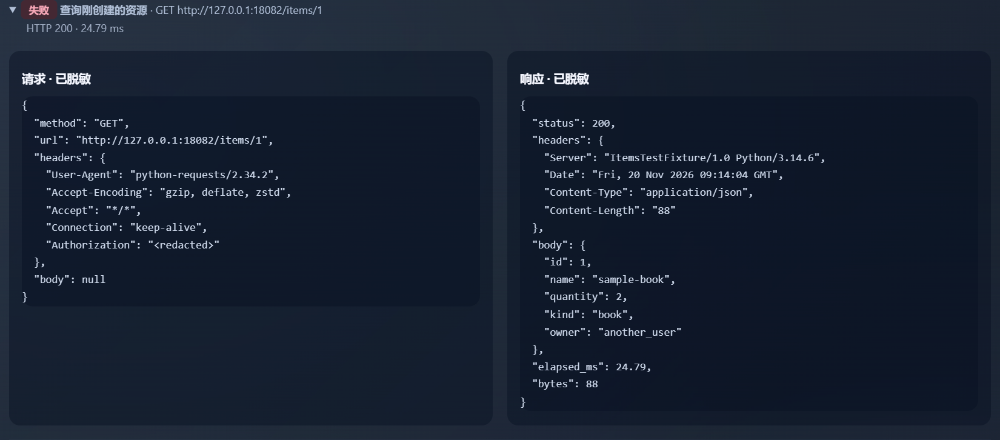

# 探真 VERIQ · API 与页面测试工作台

把接口文档、用例、执行结果和证据放在同一个工作台。VERIQ 支持导入 OpenAPI 和需求资料、运行接口测试、管理页面测试与缺陷回归，并可通过 MCP 与 Codex 协作。

VERIQ is a self-hosted workbench for API and browser QA. It links test cases, execution evidence, and retest rounds. The built-in Items example runs entirely on your machine.

## 先看实跑报告

**接口返回 HTTP 200，资源归属断言失败。** 本地 Items 模拟服务返回了 `owner: "another_user"`。报告保存了脱敏后的请求、响应和断言结果。恢复正常响应后，同一条用例重跑通过。

[下载示例报告 ZIP](https://github.com/coewarrior/veriq-workbench/releases/download/v0.17.138/veriq-items-demo.zip) · [在本地复现](examples/items/README.md#验证工具确实能检出错误)

## 快速开始

- [运行网页工作台](docs/LOCAL_WEB.md)。使用 Linux（Windows 用户可用 WSL2）、Python 3.11+ 和 PostgreSQL。文档包含用 Docker 初始化本地数据库的完整步骤。
- [运行 Items API 示例](examples/items/README.md)。只需 Python 3.11+，可以在 Windows 或 Linux 上执行。
- [连接 Codex / MCP](README_MCP.md)。先启动工作台，再安装 `python -m pip install -e ".[mcp]"`。

## 跑一轮 API 测试

[Items 示例](examples/items/README.md) 提供一个本地 API、OpenAPI 文件和测试规则。可以依次体验导入、生成、校验、执行和重放，再打开生成的 HTML 报告核对请求、断言和数据清理结果。

## 功能文档

| 场景 | 入口 |
| --- | --- |
| 接口用例、执行和报告 | [CLI](README_MVP.md) |
| 页面用例、浏览器执行和同轮补测 | [页面测试工作台](docs/UI_WORKSPACE.md) |
| 需求资料与覆盖梳理 | [需求测试](docs/REQUIREMENTS_TESTING.md) |
| 测试账号分配 | [账号管理](docs/ACCOUNTS.md) |
| 报告审核与协作 | [报告协作](docs/REPORT_COLLABORATION.md) |

## 开发与反馈

后端、CLI、MCP 和静态资源在 `api_test_tool/`，前端构建项目在 `frontend/`，测试在 `tests/`。欢迎提交 [Issue](https://github.com/coewarrior/veriq-workbench/issues) 或 PR。提供本地示例可重现的步骤，可以帮助维护者更快定位问题。

GitHub 首发基于 [Gitee 已发布源码](https://gitee.com/Code_Warrior/api-test-workspace/tree/1d27ada6455251f2caaedaeff739a14a8acd0ac0)。项目沿用 [木兰宽松许可证第 2 版](LICENSE)，第三方资源的许可与归属见各自目录中的声明。
