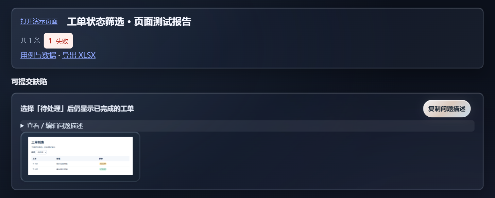

# 探真 VERIQ · 页面测试工作台

把需求、页面用例、浏览器执行、截图证据和缺陷复测串在同一个工作台。可以用 Codex 探索页面并执行用例，在 VERIQ 里看结果、审核缺陷，再用原用例开一轮复测。

VERIQ is a browser QA workbench for tracking test cases, screenshot evidence, defect review, and regression rounds with Codex and MCP.

## 先看页面测试报告

**筛选「待处理」，列表里仍出现已完成工单。** 用 Playwright 操作本地演示页面，首次报告保留失败用例、复现步骤和现场截图。修正筛选逻辑后，用同一条用例复测通过。两轮报告都可以打开核对。

[下载页面测试演示 ZIP](https://github.com/coewarrior/veriq-workbench/releases/download/v0.17.138/veriq-ui-demo.zip) · [查看页面测试工作流](docs/UI_WORKSPACE.md#ui-流程)

解压演示后，打开 `before/index.html` 查看失败报告，打开 `after/index.html` 查看复测结果。演示包还包含测试页面、用例和原始截图。

## 快速开始

1. [启动网页工作台](docs/LOCAL_WEB.md)，使用 Linux（Windows 用户可用 WSL2）、Python 3.11+ 和 PostgreSQL。
2. [创建页面测试会话](docs/UI_WORKSPACE.md#ui-流程)，填写目标页面和要验证的需求。
3. [连接 Codex / MCP](README_MCP.md)，从工作台交接本轮任务。执行后回到工作台审核用例、截图证据和缺陷。

## 功能文档

| 场景 | 入口 |
| --- | --- |
| 页面用例、浏览器执行和同轮补测 | [页面测试工作台](docs/UI_WORKSPACE.md) |
| 需求资料与覆盖梳理 | [需求测试](docs/REQUIREMENTS_TESTING.md) |
| 测试账号分配 | [账号管理](docs/ACCOUNTS.md) |
| 报告审核与协作 | [报告协作](docs/REPORT_COLLABORATION.md) |
| API 测试 | [Items 示例](examples/items/README.md) · [CLI](README_MVP.md) |

## 开发与反馈

后端、CLI、MCP 和静态资源在 `api_test_tool/`，前端构建项目在 `frontend/`，测试在 `tests/`。欢迎提交 [Issue](https://github.com/coewarrior/veriq-workbench/issues) 或 PR。报告页面测试问题时，可以附上可公开的步骤、预期与实际结果。

GitHub 首发基于 [Gitee 已发布源码](https://gitee.com/Code_Warrior/api-test-workspace/tree/1d27ada6455251f2caaedaeff739a14a8acd0ac0)。项目沿用 [木兰宽松许可证第 2 版](LICENSE)，第三方资源的许可与归属见各自目录中的声明。
