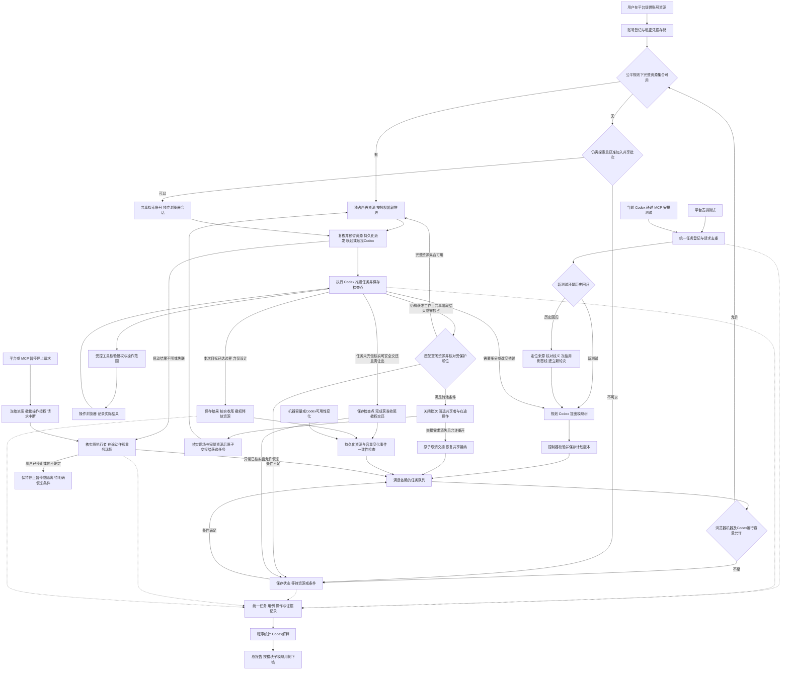
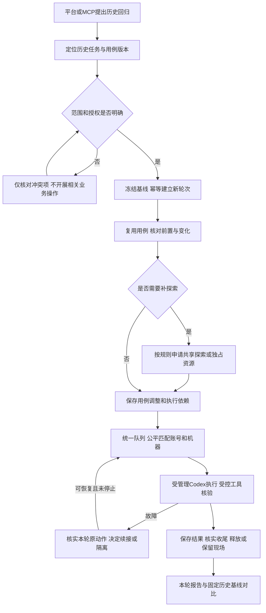
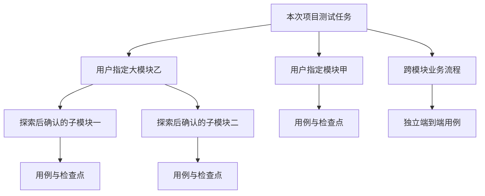
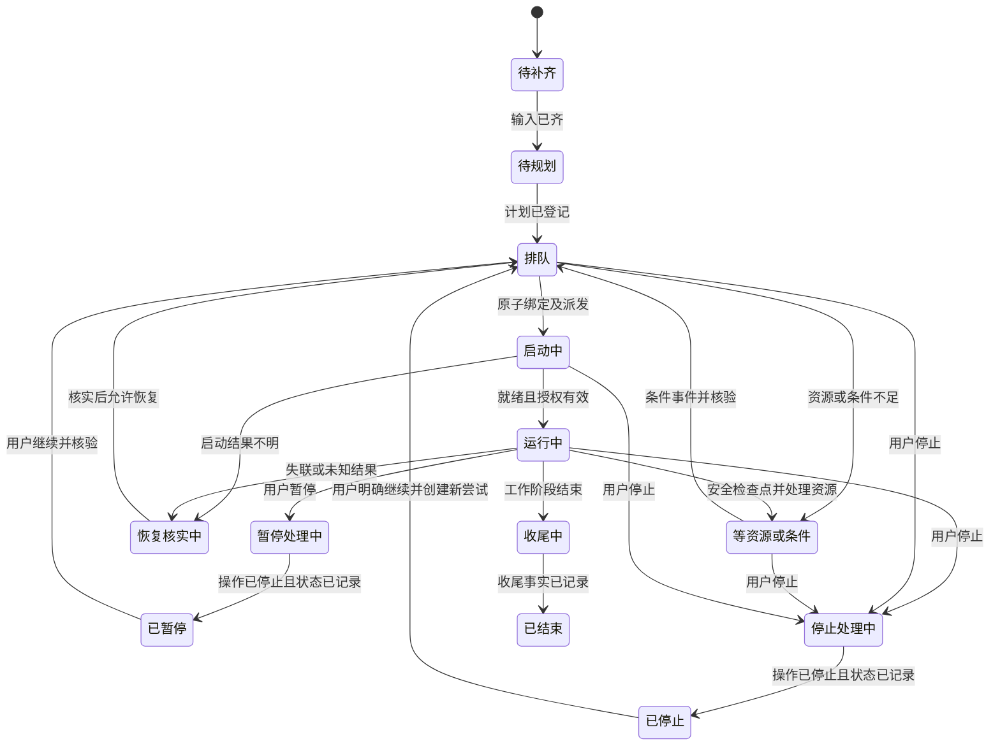
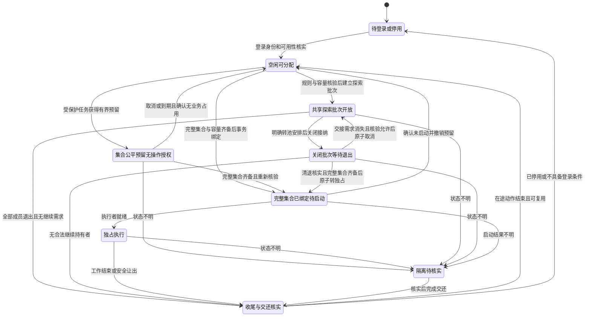

# 多任务并发测试平台设计方案 模式 A 待确认稿

版本：v1.10　日期：2026年10月15日　状态：D01至D15、C01至C03及历史回归流程已采纳，P01和P02推荐值待确认，尚未实施

本方案解决多个测试任务并行时的账号争抢、重复操作、资源长期占用和报告分散问题。采用模式 A：用户可以在平台或当前 Codex 聊天中安排任务，实际测试统一由平台控制器通过执行连接程序管理的 Codex 完成。

D01至D15、C01至C03及历史回归流程均已采纳。账号按真实身份统一管理，探索与执行采用不同持有规则；共享探索依据经过核验的操作集合，执行坚持一号一任务。分配按资源容量与公平规则动态进行，按安全业务阶段交还及联合申请多资源。平台保存事实和授权，连接程序管理Codex运行，受控工具核验操作，报告按版本汇总。第十四节分别列明已采纳策略、整体审阅修正、待确认参数及已采纳的补充决策；参数未定不等于策略未采纳。本文中的服务、接口和状态均为目标设计，不表示现有平台已具备相应能力。本文不授权修改平台、启动测试或发布上线。

# 一 设计范围与基本约束

## 1.1 已采纳的方向

- 同一项目按照用户指定模块拆分测试；大模块经实际探索后按功能继续拆分，不凭空扩展授权范围。

- 测试过程包括实际探索、用例设计、执行，以及执行中的用例补充。探索可能需要登录和真实页面操作，不等同于离线黑盒设计。

- 执行池一号一任务；探索池允许一号多任务，但每个任务使用独立浏览器会话，只能开展获准共享的探索。

- 初始配置通常为一个探索账号，其余为执行账号。优先用空闲执行账号贯穿探索、设计和执行，超出的任务进入共享探索。

- 探索批次结束时，最后持有者可在目标包含执行、身份和完整资源集合就绪、公平规则及交接核验均满足后沿用账号独占执行；其他任务保存已完成设计并等待匹配资源。仅设计任务到达设计边界后收尾。

- 平台与 MCP 两个入口共用任务登记、调度、资源控制和报告，不建立两套占用记录。

- 当前聊天只负责安排与查询；平台管理的执行者负责实际测试。账号分配不由各执行 Codex 自行争抢。

- 程序执行确定规则；Codex负责业务理解、拆分建议和结果解释。结构化计划通过校验，不等于业务判断必然正确。

- 用户停止、资源等待、系统异常分别处理。没有可靠证据时，不把失联视为资源空闲，不把未知结果视为可重试。

## 1.2 正确性边界

独立浏览器会话隔离标签、Cookie 和本地状态，但不隔离账号服务端数据。不同账号也可能共同修改同一租户的全局配置。账号互斥之外，已识别的共享业务资源仍需额外约束。

共享探索仅在已界定并核验兼容的操作集合内开放；效果未知或不能满足当前共享条件的动作转为待独占探索。获准的隔离写入仍受对象、影响范围和成员兼容性约束，不能依靠AI临场猜测并发影响。独占只解决资源互斥，不扩大业务授权。

平台只能强制管理经过受控入口的操作。执行环境若允许任意浏览器、直接网络请求或其他旁路访问业务系统，就不具备本文要求的强制约束。集成验收必须覆盖这一前提。

账号、机器和模型容量有限。唯一匹配资源失联或存在未核实操作时，安全与立即复用不能同时保证。此时隔离并展示原因，不承诺固定时间内一定分配成功。

# 二 角色与职责

| 角色 | 主要职责 | 不应承担或声称的能力 |
| --- | --- | --- |
| 用户 | 提供目标、范围、账号资源，调整或停止任务，确认待定策略 | 不必反复在两个入口创建同一任务 |
| 当前聊天 Codex | 理解意图，通过 MCP 登记、补充、查询和传达控制请求；可提出规划建议 | 不直接执行模式 A 的业务测试，不自行占用账号 |
| 规划 Codex | 根据目标与探索结果提出模块树、依赖、角色要求及计划修订 | 不直接批准账号授权，不把推断当成程序已验证事实 |
| 平台控制器 | 保存状态，校验计划结构，安排队列，原子分配资源，派发、停止、恢复及审计 | 不阅读自然语言后自动判断全部业务影响 |
| 执行连接程序 | 在执行机器上管理 Codex 实例和浏览器服务，记录派发回执、运行状态及恢复位置 | 不接管任意外部桌面聊天，不把进程中断当业务回滚 |
| 执行 Codex | 探索、设计、执行、补充用例、记录观察和提出计划调整 | 不绕过工具授权，不自行重新执行结果不明的写操作 |
| 受控工具与浏览器服务 | 逐次核验执行者、授权版本、账号、动作范围和资源约束，记录操作与证据 | 不把成功发出点击等同于业务成功 |
| 报告服务 | 汇总事实、统计状态、组织证据、保存报告版本 | 不借模型总结改写用例结论或补造证据 |

“模块 Codex”不是一种特殊产品能力。设计中，一个可执行叶子任务绑定一个有效执行者和可续接的执行上下文；不按每条用例创建聊天。规划工作可以使用独立规划上下文，无需业务账号；需要真实页面探索时，由取得资源的执行任务完成。

# 三 完整执行图

实线表示调度和操作流程；虚线表示记录汇总。等待不是持续运行模型的循环。

为保持总图可读，单独账号状态、子任务状态和精确交接条件在后文展开。由隔离恢复、暂停恢复或转池触发的重新调度，都必须再次校验最新控制版本，不能沿用旧派发。 图中账号路径适用于需要业务账号的阶段；纯规划、离线设计和报告只申请实际所需运行容量。共享池无可执行探索分支时不加入；仅设计任务不得因转池自动进入业务执行。

# 四 账号提供与两个任务入口

## 4.1 账号提供

建议入口为“项目 → 测试资源 → 账号管理”。任务选择已授权的账号组；缺账号时返回该项目的填写入口，保留任务，不要求用户在聊天内粘贴密码。

| 配置 | 作用 |
| --- | --- |
| 系统目标与环境 | 限定账号可用于哪个系统和环境 |
| 租户及真实账号标识 | 建立跨项目一致的占用身份，避免同一账号重复登记后被双重分配 |
| 角色及可访问模块 | 进行资源匹配 |
| 登录方式与凭据引用 | 支持密码或人工完成登录后使用会话；秘密与任务材料分离存储 |
| 允许共享探索及条件 | 决定能否加入探索批次 |
| 初始用途 | 初始探索池或执行池归属 |
| 状态与禁用原因 | 可用、待登录、停用、隔离等 |

账号长期身份与当前池归属分离。转池更新持有模式，不复制账号。身份无法确认时不能推断两个登记项互不影响。登录态不是普通附件，不进入 Git、聊天、用例、日志或报告。 同一真实账号的多个角色或可切换租户不产生额外执行容量，仍按一个账号统一占用；业务身份与真实身份分开记录。登录态保留不等于旧执行授权保留，账号交还后旧执行者不能继续操作。 真实账号唯一性跨项目判重，账号权限与资源状态分别管理；项目间共享调度事实不授予查看其他项目报告、凭据或现场的权限。

人工登录只授权当前指定账号和目标。登录后须核对实际账号及租户；账号允许多会话、是否会踢出其他登录、会话可用期限均需验证。人工一次登录不代表能无限复制会话。 同一真实账号的登录恢复需统一协调，防止多个任务同时重新登录、互相踢出。恢复后逐会话核对状态，不能假定一处登录成功等于所有会话有效；已经停止的任务不因登录成功自动续跑。

## 4.2 两个入口的共同流程

两入口使用同一任务创建和控制服务、权限域、账号目录及队列。MCP 连接授权与业务测试授权分别判断；仅连接不产生测试任务。请求只能访问当前用户已获授权的项目和账号组。

平台接收请求后返回任务 ID、报告入口、请求标识及真实状态，区分“已接收”“等待资源”“正在启动”“正在执行”。当前聊天不得把接收回执说成实际已执行。

| 用户意图 | 登记和处理 |
| --- | --- |
| 连接测试台 | 完成连接后等待任务，不自动选择历史项目 |
| 指定系统和若干模块 | 创建一次测试任务，按模块形成初始任务树 |
| 指定大模块但未知内部结构 | 建立待细分任务，取得资源后探索再细分 |
| 缺少必要目标 | 保留已知要求，补齐目标再开展业务操作，不猜历史地址 |
| 多项目测试 | 各项目建立独立测试任务及报告，共享账号目录按真实身份互斥 |
| 无匹配账号 | 登记等待原因并提供填写入口；可做无需业务账号的准备 |
| 追加模块 | 若明确属于原任务，更新范围与计划版本，保留已有进度 |
| 另起任务还是追加不明确 | 结合上下文判断，确有实质歧义时确认，不按项目名直接合并 |
| 继续已有任务 | 查找原任务与检查点，核对可恢复条件，不全量重跑 |
| 明确重测一轮 | 新建执行轮次，关联旧轮次，保留原报告 |
| 换聊天继续同一任务 | 关联原任务并查询，不因聊天变化新增执行者 |
| 查询进度 | 只读，不触发执行或唤起 |
| 只要求探索和设计 | 到设计边界结束，不自动进入执行；探索动作仍受权限限制 |
| 补充需求与附件 | 绑定原任务、保存来源，评估受影响范围；文件内容不构成额外授权 |
| 接口测试或需求审查 | 使用对应执行路径，不无条件等待 UI 账号 |
| 回归历史模块 | 定位源任务与用例版本，解决实质歧义后建立新轮次，按4.7统一调度 |

## 4.3 重复请求与并发控制请求

网络重试沿用同一请求标识，返回原处理结果。相同标识而载荷不同应拒绝并解释冲突。相同文本不等于同一请求；用户明确要求再测一轮不能被吞掉。

用户再次说“开始”时先核对当前关联任务是否正在执行。停止请求与派发竞争时，以持久化的最新控制版本为准：冻结待派发项；迟到的启动回执也不能获得业务授权。 继续、改范围和计划更新携带其所依据的控制版本；迟到的旧继续请求不能覆盖更新的停止意图。两入口并发修改用条件更新核验冲突，保留请求回执，不按消息到达顺序盲目覆盖。

关闭当前聊天不停止平台任务。用户明确停止平台任务时，进入停止流程。当前聊天原本已在直接操作浏览器的旧任务，必须先停止原执行、保存并交接现场，再转入模式 A，不能因连接 MCP 自动视为已接管。

## 4.4 多角色多租户匹配

账号登记真实身份、业务身份和使用条件三类信息。真实身份用于跨项目统一占用；业务身份包括环境、租户、角色和有效权限；使用条件包括登录状态、共享探索资格、当前占用和现场绑定。

任务必须说明身份用于操作准备还是测试断言。获准准备数据时可以匹配具备相应能力的账号；验证普通用户拒绝访问、租户隔离等场景必须使用指定业务身份，不能用管理员或其他租户代替。不同账号修改同一租户配置时仍需业务互斥。

一个探索账号加若干执行账号是常见起步配置，不是全平台固定只允许一个探索账号，也不要求每租户每角色永久预留。多个兼容探索需求出现且资源允许时建立对应批次；只有一个任务时可直接独占完成探索到执行。现有账号与任务不匹配时明确等待原因，不擅自改变测试身份。

同一登录账号可切换租户时仍按一个执行资源占用，切换属于当前任务的受控操作并需核对实际租户。跨会话跨租户共享探索须验证租户切换和会话是否互相影响，未验证前不开放。需要管理员及普通用户关联验证的流程显式登记多身份需求，不借用其他任务占用中的账号；多资源获取按已采纳D15的阶段资源集合及安全交还规则执行。

在D04公平约束下联合匹配候选任务和账号。例如A能满足甲乙、B只能满足甲时，优先甲用B、乙用A，避免灵活任务占掉别人的唯一资源。不为未来可能出现的任务提前闲置账号。 已登记、就绪且受保护的多资源任务按D15进行有界集合预留，属于明确的现有需求，不属于为假想未来任务留号。

## 4.5 人工登录与登录恢复

选择账号并创建受控会话后，任务进入待人工登录，展示目标系统、预期账号、租户和操作入口。用户在指定会话完成扫码或验证码，平台核对实际身份、租户和所需权限，且任务仍获准运行，才能执行。扫错账号不得自动视为可接受替代。

等待人工时结束活跃推理，其他账号任务继续；不预占后续可能需要的其他账号，也不把当前待登录账号同时交给另一任务执行。挑战失效后明确要求重新登录，浏览器及账号按现场核实处理，不无限刷新二维码或催促。密码走专用私密入口，认证秘密不进入聊天、用例、报告或普通截图证据。 多资源阶段初始化需要人工登录时，其他已预留资源也须重评；确认无业务操作且无现场约束的预留可安全撤销，需保留的记录原因，不能无限占齐账号等人工。

共享探索账号失效时，协调暂停受影响会话的新操作并保存各自检查点，只发起一次登录恢复流程，随后逐会话核验。若登录会踢出其他会话，停止继续共享接纳并调整安排，不能用反复登录维持虚假并发。

执行中跳到登录页时，保留原对象、最后确认步骤及未决动作。恢复登录后先核实原提交是否成功，从原现场续接，不回首页重建业务对象。用户已停止或暂停任务时，登录恢复仅改变账号可用性，不覆盖最新任务控制状态。

## 4.6 登录态现场与证据保留

| 保留对象 | 内容 | 对占用的影响 |
| --- | --- | --- |
| 登录态 | 私密Cookie、令牌或会话引用 | 不必持续占账号，复用前核实身份与有效性；旧授权必须撤销 |
| 业务现场 | 页面、未完流程、对象、账号或租户配置状态 | 可能须保留账号或业务资源，按D06核实 |
| 测试证据 | 截图、操作记录、观察结果及对象引用 | 通常不需要继续占账号 |

只保留证据时完成取证并满足交还条件即可释放；保留已完成流程的数据时，核实后续操作不会破坏它再决定是否可复用。原页面等待人工接手时保留对应会话，并分别判断账号及业务资源。要求记忆、权限或设置保持原样时，若其他任务会影响就继续占用。租户全局配置保留可能影响同租户其他账号，不能仅锁一个浏览器。

保留范围尽可能精确但必须已核实。不得通过“保留现场期间另一个任务受限使用同号”重新引入执行共享。平台只能约束自己管理的执行者，不能保证人工或外部系统不修改现场；恢复和接手时重新核对实际状态。

每份保留记录明确对象、范围、原因、负责人、影响的等待任务及解除方式，可以登记复核时间并提醒。到期不自动删数据、退出登录或强制释放；负责人决定继续保留或确认取证充分后交还，交还前仍需核实在途动作与必要收尾。缺陷现场保留是可见的资源占用，不是后台遗忘状态。

## 4.7 历史任务回归

历史回归流程已采纳。两个入口共用同一套历史定位、范围解析与轮次登记规则。当前聊天Codex识别意图并查询历史；平台保存明确的任务、用例及版本引用，按统一策略分配资源。不会直接把历史聊天全部唤醒当作新回归。

1. 定位来源：根据用户指定的聊天、任务、报告或项目批次查找历史记录；聊天只提供线索，平台任务与用例记录确定范围。无法读取的记录列为待核实，不凭聊天摘要重造原用例。

2. 消解实质歧义：范围唯一且授权清楚时直接承接；存在多批候选、数量不符或曾停止模块是否纳入等冲突时，只核对冲突项。明确“原六项全部重新回归，包含知识库”即构成新轮次的范围选择，不需重复确认。原轮次的停止状态和已停监听不因此解除。

3. 冻结回归基线：为新轮次保存来源批次及各模块来源轮次、用例稳定身份和版本、范围、环境、角色要求、约束及选择理由。多模块可以来自不同历史轮次，但必须列明，不拼成不存在的统一历史批次。源记录后续更新不静默改变本轮基线。

4. 建立新轮次：复用已有模块和用例身份，创建新的执行记录；原结论、证据和报告保留。已有在途旧轮次不自动停止，也不因新回归重复占用旧现场。

5. 准备与补充探索：无需账号的材料整理先执行。原用例适用时直接核对前置并回归；变化部分才补探索。共享探索须满足D01操作边界和实际兼容条件；需要独占的探索申请执行资源。旧阻塞重新检查，不能照抄；新发现与用例调整留痕，不静默删除原范围或放宽断言。

6. 统一调度：按账号身份、机器容量、依赖、公平顺位和当前授权派发。独占账号覆盖必要探索、前置和执行；溢出且可共享的探索加入探索池；已准备就绪的任务直接等执行账号，不为了利用探索池而重复探索。最后探索者转池继续遵守公平保护和原子交接。

7. 处理跨模块前置：需要读取同一账号产生的数据时，明确同号依赖和对象归属，安排顺序交接或合适的共同执行单元，不假定换号可保留前置，也不恢复执行账号共享。多资源获取按已采纳D15执行，不能无限持有部分资源等待。

8. 本轮恢复与停止：检查点、操作和授权绑定本轮。断线后核实原动作再续接；停止后资源空闲或登录恢复均不自动重启。特别核对旧定时计划、公开测试站和保留现场，结果未知不重复创建，不擅自清理。

9. 汇总与对比：生成本轮总报告及模块报告，按固定基线比较，分别列出新增、变更、不可比和未执行项，不能把上轮通过计入本轮通过。

| 用户表述 | 处理 |
| --- | --- |
| 回归上次六个测试 | 原六模块范围的新轮次，包含原通过、失败及未完成用例；不具备条件的如实记录 |
| 把上次没测完的继续测 | 续接原轮次，仅推进剩余范围 |
| 复测上次的缺陷 | 新建复测轮次，选失败用例及必要关联验证 |
| 再测一轮 | 建立另一新轮次 |
| 提交超时后重试 | 使用同一请求标识核对并返回已有轮次，不重复创建 |

请求标识应在发送前保存；同一请求重发只登记一次。单纯文本相同不能作为永久去重依据；用户明确另测一轮使用新请求。若请求标识丢失且是否成功不明，先查关联登记记录再判断。

示例：原六模块为企业知识库、长期记忆、技能与连接器、定时任务、通知和招聘官网，其中一个曾明确停止。模糊“六个都回归”需解决该项是否重纳的冲突；明确包含后建立新轮次。假设3个执行账号加1个探索账号且机器容量足够，先派发3个匹配的就绪任务；其余仅在需要且安全时共享补探索，准备好的直接等待执行账号。模块数不等于同时运行的Codex数量。

# 五 模块拆分与计划校验

## 5.1 任务树

项目是长期容器，“本次测试任务”是一次明确范围的工作。报告模块表示用户理解的业务范围；执行任务表示可独立准备、执行和交付结果的工作单元；任务内检查点表示保存进度和核实能否安全交还的位置。一个报告模块可以包含多个执行任务，一个执行任务可以有多个检查点，不要求三者一一对应。只有可执行叶子申请资源，汇总父节点不重复执行和统计。

拆分依据是业务独立性，不按固定分钟数、用例条数或账号数量硬拆。围绕同一对象的创建、修改、禁用、验证和收尾可放在一个生命周期任务内，各用例仍分别记录结果；可独立准备文件和数据的批量导入可另拆。业务模块拆开不代表自动允许并行，同租户全局配置等影响仍受资源互斥约束。

| 判断维度 | 更适合拆开 | 更适合保留在同一任务 |
| --- | --- | --- |
| 前置准备 | 可独立准备且成本合理 | 会重复大量相同前置 |
| 业务状态 | 对象及影响独立 | 前后依赖同一对象或账号状态 |
| 结论 | 能独立完成真实断言 | 单独只能观察流程的一部分 |
| 收尾与恢复 | 有明确安全结束和续跑位置 | 提交、等待、验证不可安全分割 |

大模块探索前可以暂时作为可执行叶子。拆分时到达安全边界，保存探索结果并提交新计划；父节点转为汇总节点，已有用例和事实明确归属到子节点。原账号如继续由一个子任务使用，须完成执行权和资源归属的原子交接，不能让父子同时持有；其他子任务重新调度。 执行中发现模块过大时，只在安全检查点把尚未开展的独立部分细分；不拆断正在进行的强关联流程。父子和子任务之间不复制已完成工作或受保护资格。只有一个可用账号时仍可按业务组织任务并串行，不为制造并发重复准备同一现场。

一个共享前置或跨模块流程可设独立任务，并显式关联被依赖者。几个模块分别通过不代表跨模块流程通过。拆分不能减少授权范围内的负向、边界、恢复等独立检查。 按已采纳C02，稳定共享前置有独立归属、消费者与业务状态依赖；创建者结束不触发盲目删除，最后一个依赖解除并核实现场后才按授权收尾，详见5.4。

## 5.2 计划从建议到执行

规划 Codex 提交任务 ID、父子关系、范围引用、依赖、阶段、角色及资源需求、预期产物。平台校验唯一标识、无环结构、范围关联、有效版本、依赖引用和资源可匹配性。

业务依赖是否完整、模块边界是否合理，由 Codex依据需求与探索证据判断；未核实的条件要明确标记。程序不因计划格式正确就宣布业务前置已就绪。

普通账号释放只触发按既有计划重新调度，不必每次调用规划模型。发现新功能、依赖变化或用户修改范围时才修订计划。普通结构细分在安全边界影响适用的未执行部分；权限收紧立即限制新动作；业务规则变化按D14标记已测结论的适用版本并安排必要补测。已经发生的操作保留事实和当时版本，不被新计划改写。

## 5.3 修改范围

追加模块进入原任务树；移除模块停止对应节点及子节点并保存历史。影响其他节点依赖时重新评估相关部分，独立模块可以继续。

已授权范围内的细分与补充用例自主推进；必要关联准备仅在目标、对象、动作及影响均符合既有授权时执行最小前置。Codex提出结构化依据，平台与受控工具核验，不因标为“必要”自行扩权。真正超出范围只确认新增部分，其他独立分支继续。权限收紧和停止立即限制新操作，普通计划细分在安全检查点交接；规则变化保留旧结论并仅重评受影响范围。具体规则按已采纳D14执行，详见14.3。

## 5.4 共享前置生命周期

按C02，仅复用业务条件明确且适合复用的前置。保存对象ID、环境、归属、状态及版本、消费者、收尾授权和负责人。消费者在使用前登记所需状态，不只登记对象存在；若不同消费者要求互斥状态，则改为同一执行单元内顺序推进或独立准备，不能为了节省前置而污染断言。

创建任务结束或被停止，不自动删除下游仍依赖的对象。可核实保留后移交收尾责任；用户明确删除对象时，阻止受影响下游的新动作、核实在途操作，再按授权删除并记录前置撤销，不能冒充产品失败。消费者失联不等于依赖解除。

最后一个消费者解除依赖后，核对所有在途动作、保留要求及清理权限，再调度收尾。新消费者登记和清理资格判断互斥：已经进入清理的对象不能直接分配给新任务；登记先成功则不得清理。收尾失败保留待办、对象归属与责任，不能把记录删掉即视为对象已删除。

对象是否保留与账号是否交还分别核实；允许保留对象不等于要求账号永久占用，也不允许多个执行任务共享一个账号。

# 六 任务状态流转

任务阶段、运行状态、用例结论、资源状态是四个独立维度，不能用一个“完成”字段替代。

## 6.1 阶段与运行状态

阶段为：范围规划、探索、用例设计、执行、收尾。探索与设计可迭代；执行中新发现的分支回到相应探索或设计步骤，同时保留已完成结果。

| 运行状态 | 含义与离开条件 |
| --- | --- |
| 待补齐 | 缺少必要目标或输入，补齐后进入规划 |
| 待规划 | 规划尚未完成，保存有效计划后进入队列 |
| 排队 | 依赖已满足，等待执行容量或派发 |
| 等资源 | 缺匹配账号或其他资源，由资源事件触发重评 |
| 等条件 | 等外部业务条件，按事件或有界复查触发重评 |
| 等人工 | 需要明确人工输入，输入完成后先核实现场 |
| 启动中 | 已保存派发记录，等待执行者就绪 |
| 运行中 | 已确认有效执行者，正在推进某一阶段 |
| 暂停处理中或停止处理中 | 冻结新操作，核实在途动作，不等同于已停妥 |
| 已暂停 | 不自动唤起；用户明确继续后校验并恢复 |
| 已停止 | 本次尝试结束；明确继续可开新尝试承接检查点，旧尝试不改写 |
| 恢复核实中 | 执行或业务状态不明确，核实后决定重排、隔离或待人工 |
| 收尾中 | 保存结果、核实清理或保留现场、交还资源 |
| 已结束 | 执行流程已终止；结果可含通过、失败、未执行或阻塞，不等于全通过 |

图中省略了从规划、人工等待和恢复核实等状态发起停止的同类边：所有非终态都受控制版本约束。暂停或停止处理中若现场不明，保留该意图并进入核实，不因异常自动恢复执行。

## 6.2 状态不变量

- 一个叶子任务至多一个有效执行者；一次尝试可跨多个 Codex 轮次，等待时不持续消耗模型。

- 已暂停或已停止不得被资源空闲事件自动唤起。

- 运行状态终结不代表资源已可用；未核实现场可继续处于隔离状态。

- 报告保存不代表任务完成；用例通过不代表模块覆盖完整。

- 父任务显示子任务状态分布，不能只因某个模块已发布报告就显示整体完成。

- 需要业务账号却尚未取得授权的任务不能显示为正在进行页面探索；无需业务账号的规划、离线整理和报告可独立推进。

# 七 账号分配与探索转执行

## 7.1 分配顺序

1. 先核对用户权限、任务范围、环境、租户、角色、依赖及最新控制版本。

2. 根据当前账号、浏览器会话、机器内存与负载、Codex运行容量和已登记业务互斥条件动态判断能否派发，不固定最多4个任务，也不固定同号共享3个任务。资源保护线根据实际环境确定，不能用未经验证的任务数替代。

3. 在既有公平保护及完整资源匹配规则下优先使用空闲执行账号，独占推进获准阶段；需补探索时贯穿探索、设计和执行，仅设计任务仍在设计边界结束。

4. 执行资源不足时，仅有获准共享探索分支且批次开放的任务加入探索池；已经完成设计、只需执行的任务直接等待执行资源，不重复探索。

5. 没有安全匹配资源时保存等待原因和所需条件，退出活跃模型轮次。

6. 资源或条件变化后重新评估，仍按公平策略选择，不由执行者自己抢账号。

任务计划与账户分配分层：Codex提出模块顺序和资源需求；控制器按策略作出实际分配并记录原因。占用的检查与写入必须在同一事务内完成，多控制器部署也不能仅靠进程内锁。

多账号或额外业务资源按已采纳D15申请下一安全阶段的最小完整集合，齐备后原子授权。固定加锁顺序只可作为数据库内部实现手段，不能替代完整集合判断。未齐备不新增部分业务操作授权；受保护任务可有界预留，已有现场的动态依赖按7.7核实交还或明确处理。

## 7.2 账号状态图

“空闲”表示已验证可分配；无心跳、租约到期或没有模型输出都不是进入空闲状态的充分条件。已停用账号在释放后仍保持不可分配。 公平预留、完整集合绑定、有效业务操作授权分别记录；预留中的账号不算空闲可争抢，但也不能据此开展业务动作。图中已绑定待启动的状态同样用于探索转独占后的就绪核验，不强制重建可复用浏览器。

## 7.3 探索批次

一个批次表示账号处于共享探索模式的一段使用期，记录允许的操作集合、当前成员、动态运行容量、接纳状态和转池安排。没有交接需求且各项资源允许时接纳新任务，不按固定5分钟、首个成员完成或固定人数自动关闭。成员加入与关闭接纳必须互斥，不能同时获得共享与独占授权。

需要让最后探索者沿用账号执行，或按D04、D05保护等待任务的规则安排交接时，登记明确的转池目标和原因，停止接纳新成员；已有成员继续完成或在安全边界退出，不因关闭接纳被强行标记为完成。需要靠该账号兑现受保护顺位时，不得不断接收新探索者而延后交接；其他资源满足等待任务后再重评原交接是否必要。

等待交接期间若其他账号释放等变化使原交接需求消失，应重新评估：在尚未转为独占、没有未决操作或隔离、且公平规则允许时，可原子取消交接安排并恢复共享接纳。不能仅因有新任务到来就重开，也不能在独占已生效后继续共享。状态与授权版本同步更新。

探索任务完成、遇到需独占步骤或准备转到其他执行账号时，先保存结果与必要现场引用，停止自身操作，再退出共享持有。退出后不再使用旧授权。账号中留下的数据登记归属，不自动删除其他成员仍依赖的数据。 同一事务核对最后成员退出与新成员加入；成员归零且无合法继续需求时关闭批次、核实后释放。目标任务停止、取消或身份变化时取消原交接目标并重评，不能留下无人持有却不可分配的批次。

暂时没有探索池时：一个待探索任务可独占空闲账号贯穿执行；多个待探索任务可依据公平策略将一个空闲账号组建为新探索批次。不能把正在独占执行的账号临时借出。

## 7.4 转池事务与交接

最后持有者沿用账号执行需同时满足：

- 批次已关闭，不再接受新成员。

- 其他共享授权均已退出或撤销，且在途操作已结束并核实。

- 目标任务尚未暂停或停止，剩余阶段仍在授权范围内；角色、依赖、浏览器和运行容量及其他必要资源已经联合核验。仅设计任务不得通过转池进入执行。

- 账号未被隔离，共享探索遗留数据与执行前置已核对。

- 同等优先级下，本次沿用不会再次越过持续就绪、资源匹配且已受保护的等待任务；否则保存探索结果，安全交还或交接，不自动让最后探索者独占。

在一个事务中更新账号模式、唯一持有者、任务绑定和授权版本，保存转换事件。过程不暴露空闲窗口；重复请求返回原转换结果，载荷冲突则拒绝。 沿用不获准时，最后探索者先保存现场并停止操作，再核实能否安全交还给受保护任务；状态不明则隔离，不能以公平调度为由强抢。

跨账号转执行只迁移可复用的设计、观察和证据。账号私有数据、对象 ID、登录状态不能默认搬迁。必要前置由新账号核对或重建，并记录迁移成本，不把未重建现场视为已就绪。

## 7.5 公平与资源利用

先判断环境、角色、依赖及当前运行容量是否匹配，再安排实际分配机会。普通分配在同等优先级下采用项目间轮转、项目内等待顺位；没有其他可运行竞争者时，允许当前项目使用剩余资源，不为形式公平闲置账号。资源不匹配的队首任务不阻挡其他账号推进。

等待顺位、实际分配机会及因沿用被越过的记录持久保存，跨账号、跨探索批次使用。模块拆分、失败恢复不能清零已有等待，也不能把一次受保护资格复制给多个子任务；新增范围作为新增工作登记。相同优先级的资源保护先于现场沿用优惠，多个受保护候选再按正常公平顺序选择。显式加急与普通优先级之间的具体关系尚未在本次确认中确定，不新增固定加急次数规则。

默认允许最后探索者沿用账号完成当前叶子任务，以减少前置重建。同等优先级下，若某持续就绪且与本次资源匹配的等待任务因此被越过，应记录本次机会，并赋予该任务受保护顺位；在其等待期间，后续匹配资源不得再次以现场沿用为由越过它。这是下一次安全分配机会的优先权，不是提前锁住某个账号，也不抢占已经独占运行的任务。

普通执行账号释放时，控制器综合匹配：有其他账号能满足等待任务，就让等待任务取得它、最后探索者沿用原账号。若唯一可交接账号必须优先满足受保护任务，最后探索者保存结果并安全交还，即使需要重建部分前置；该取舍已采纳。角色或租户不匹配的账号由其他任务使用，不算越过，也不清除保护。

沿用仅覆盖当前叶子任务。范围内必要补充检查可以继续，新增模块另行排队，不能通过追加范围或连续领取任务延长优惠。沿用结束后资源交还；不得优先重建探索批次而继续推迟受保护任务。安全交还按已采纳D06执行，模块粒度按已采纳D07划分；长任务可在业务检查点经核实后交还，不必等整模块结束，也不因公平要求硬切未完成流程。上述规则保障分配机会，不承诺唯一账号长期不可交还时的固定等待时长。

账号占用、浏览器占用和活跃推理分别计量。等待任务可结束模型轮次，释放推理容量；保留的浏览器仍计入内存和会话占用。账号是否释放取决于现场，不为填满空闲账号强迫任务迁移并重做前置；优先把空闲账号分配给适合它的其他任务。

控制器在新任务到达、任务等待或结束、资源释放、机器容量及限流状态变化时重评队列，并通过有界一致性检查补偿丢失事件。连接程序采集资源指标，不额外唤起Codex判断机器负载。逐步增加派发并根据实测反馈调整；资源紧张时先停止新增派发，再在安全边界降并发，不直接杀掉未核实的业务动作。

账号选择与执行容量校验、预留及派发需要协调，避免取得账号后长期等待运行槽位。资源保护线保留但具体数值待环境验证；“动态”不表示无限并发。等待原因须明确区分账号不足、运行容量不足、业务互斥、探索账号交接和依赖未满足。

## 7.6 长任务安全交还

长任务不按固定持有时长释放，按业务检查点及现场能否安全交接决定。无竞争时，不为形式上的释放而换号；有竞争时，由调度器在可交还位置安排让出。保存检查点是恢复条件之一，不是安全释放证明。

| 现场分类 | 判定依据 | 处理 |
| --- | --- | --- |
| 可以交还 | 当前操作结束，结果已保存，后续使用不会破坏必须保留的验证条件 | 必要收尾、撤销旧授权并交还，后续按原检查点排队恢复 |
| 必须保留 | 后续验证依赖账号状态，交给其他任务会污染结果 | 保持独占，记录原因、解除条件与下一核查事件；可释放活跃推理容量 |
| 状态不明 | 未确认提交、后台动作未核实或原执行者失联 | 隔离核实，不因等待者优先而强抢 |

交还顺序为：到达业务检查点，保存结果、对象和恢复位置；停止新的业务操作；核实在途请求、后台任务和现场保留要求；完成获准的必要收尾；撤销旧执行授权；由控制器确认交还并重新分配。阶段尚未完成的任务回到等待或排队，不因交还账号而记为完成，也不重跑已完成流程。

Codex依据观察提出交还建议，受控工具提供操作和核实记录，控制器按已登记规则作出分配决定。不能凭Codex一句“可以释放”覆盖未决业务影响。清理只涉及本任务有权处理的对象，不以恢复环境为由覆盖其他任务或用户的修改。

定时任务等待触发、长期记忆写入后等待召回等流程，若账号交还会污染验证条件，应保持独占，结束推理轮次并按业务事件续接。关闭浏览器或中断Codex不证明服务端任务已结束。不能为了释放账号取消待验证的定时任务，改变原测试条件。

等待人工规则答复且无需保留现场时可以交还；人工需要在原页面操作、用户要求现场不变或业务结果未知时，分别评估会话、账号及业务资源。优先在业务事件、人工答复、操作完成和竞争变化时核查，由控制器做有界兜底检查，不固定每隔几分钟唤起模型判断。

受保护顺位只决定下一次安全机会给谁，不生成安全交还条件。不能通过无限增加范围占号，也不能为兑现公平把尚未完成的业务流程硬切断。

## 7.7 多资源集合与动态依赖

按下一个能安全结束或交还的业务阶段申请最小完整资源集合，联合匹配账号、角色、浏览器容量和业务互斥资源，齐备后原子授权，不提前锁住整轮所有资源。一个任务可持有多个必要账号，每个执行账号仍只有一个任务持有。

运行中新发现依赖时，控制器检查已有持有和等待关系。可安全交还时按公平与重建代价安排让出，保留原等待保护；双方都不能交还时明确冲突、负责人和解除选项，不强抢或假装换号能迁移前置。对持续就绪且受保护的多资源任务可建立有截止条件的集合预留，其他不冲突资源继续使用；未齐备不发业务操作授权，超期不无限续约。具体预留参数待配置，详见已采纳D15。

# 八 Codex 唤起停止与受控执行

## 8.1 唤起流程

采用受管理的执行连接程序对接Codex App Server，固定经过验收的版本。平台维护任务、资源授权、派发和检查点，连接程序维护实际执行实例及回执，受控工具限制业务操作；当前安排任务的聊天不承担唯一调度职责，也不接管任意桌面聊天。

控制器在一次事务中验证最新计划和控制版本、绑定所需资源、创建唯一派发记录并登记待投递事件。执行连接程序收到派发后先持久化去重回执，再创建或续接它管理的执行上下文。

启动前再次核验授权。就绪回执绑定任务、尝试、派发、执行机器、实际 Codex 上下文和授权版本。只有授权有效的执行者能通过受控工具操作业务系统。

持久化投递事件支持丢失通知后的重投；连接程序按派发 ID返回已有实例，不创建副本。控制器结果未知时先查询实例，不能假定调用失败等于没有启动。 若连接程序已记录接收但在实例创建前后崩溃，区分已接收、创建中、实际上下文已确认等阶段并对账。接收回执不等于实例已启动；无法确定旧实例时先隔离派发，不能因查不到映射就盲目新建。

等待资源或条件时保存检查点并结束本轮推理；等待条件由平台持久化，后续由事件触发控制器重新核验授权并续接，不让Codex持续询问是否可运行。续接先核对原现场、业务对象和最后已确认动作，不从首页重跑。若执行上下文无法恢复，可在旧执行者已停止操作并撤权、现场已核实后建立新上下文接手，但保留原任务、用例和业务对象事实。

App Server提供创建线程、恢复线程、启动轮次及请求中断等运行能力；恢复线程后仍需启动轮次才能继续工作。账号池、业务检查点、幂等和现场核实由平台实现。具体协议版本和浏览器接入在实施前验收，不把平台任务状态等同于底层Codex单轮状态。接口依据：[Codex App Server官方说明](https://learn.chatgpt.com/docs/app-server)。

## 8.2 检查点内容

检查点包含：任务与尝试 ID、计划及用例版本、阶段、账号和会话引用、已确认步骤、业务对象引用、未决动作、证据位置、下一步、等待条件、是否允许安全交还资源及原因、必须保留的验证条件、后台未决对象、核实依据与解除条件。检查点不新增用例，也不代表账号可释放。

账号秘密不进入检查点正文；只能引用受权限控制的凭据或会话。关键业务操作前保存动作意图，实际观察后保存结果，阶段切换、人工介入和退出前提交检查点；不要求每个普通点击都唤起模型或生成报告。

## 8.3 停止流程

1. 保存用户停止或暂停意图及控制版本，覆盖选定任务和对应子任务。

2. 冻结新派发，撤销后续业务操作授权。

3. 连接程序请求中断相关 Codex 轮次并停止受管理的浏览器操作入口。

4. 核实已发出的请求、异步业务操作和浏览器实际状态。

5. 保存可恢复检查点，核实获准的收尾。普通测试授权撤销后，不恢复它来做清理；确需收尾时由控制器依据原有授权授予仅限指定对象和动作的收尾能力，记录独立回执。用户明确禁止任何后续业务动作时，仅保留证据及待办，不执行业务清理；不擅自回滚已发生的事实。

6. 确认安全后交还账号；不确定资源隔离并展示原因。

7. 返回已停止、停止处理中或待核实的真实状态。

普通资源等待优先保存进度并让执行者正常结束本轮，不把每次等待都当作强制中断。用户明确停止的任务不得被资源事件自动唤起。 平台测试停止与被测系统中的定时计划、发布页面等后台对象是不同状态；对这些对象的处理只按已明确授权的收尾规则执行，无法确认时保留待办与资源影响，不假称外部动作已经停止。

## 8.4 强制约束入口

每次工具调用必须携带任务、尝试、操作 ID和有效授权引用。工具核验任务当前状态、执行者、账号身份、授权版本、操作能力和所需业务互斥资源；无法验证时拒绝新的业务操作。

执行者仅得到必要工具能力。凭据由登录服务使用；脚本、网络和浏览器权限不能成为绕开校验的通道。未知动作的拒绝是授权边界，不记成产品失败。

撤权只能阻止新操作，不能保证已发出的请求被撤回。目标系统的后台任务可能在浏览器关闭后继续运行，需记录对应业务对象和影响资源；若确有持续影响，不能仅因本地进程退出就宣布安全释放。

## 8.5 运行部署与升级

首版优先由连接程序在执行机器本地接入App Server，平台与连接程序之间单独建立认证连接，不把执行接口直接开放给所有客户端。Codex自身登录授权与被测系统账号池分别管理；业务账号已提供，不等于Codex运行授权已具备，实施前分别核实。

平台持久化接收的任务不依赖当前聊天保持在线。执行者启动后仍须取得当前有效业务授权；启动回执丢失时先核对原派发和实例，不能盲目再建一个有效执行者。

用户停止时，先保存控制状态、冻结派发并撤销新业务操作授权，再请求中断Codex，随后核实在途动作。受控入口无法核验授权时拒绝新业务操作。中断成功不表示已发生的副作用被撤销。

升级或重启前停止接收新派发，等待安全检查点或按既定停止恢复流程处理，保存运行映射与检查点。重启后核对原任务、执行者和资源，恢复仍获准的工作，不把所有“运行中”记录重新启动一遍。上述接入方向已采纳，实际运行兼容性和故障恢复效果仍需实施阶段验证。

# 九 异常恢复与幂等

## 9.1 三层防重复

| 层级 | 唯一标识及处理 | 能保证的边界 |
| --- | --- | --- |
| 用户请求 | 请求 ID与载荷摘要 | 网络重试不重复登记；明确新一轮使用新请求 |
| 执行派发 | 派发 ID、尝试 ID与执行者版本 | 同一次派发不创建多个有效执行者 |
| 业务操作 | 操作 ID、参数摘要及结果记录 | 同一操作重复调用返回原记录；不同载荷不共用 ID |

上述机制不能独自保证目标业务系统的外部副作用恰好发生一次。支持业务幂等键时使用原键；不支持时依靠原业务对象和实际状态核实。结果未知不盲目重发。

## 9.2 故障处理矩阵

故障先分为三类：确认没有开展业务操作的连接或启动故障，可以有限自动恢复；业务结果已明确时找回记录并继续，不重复操作；业务结果不明确时先核实，不能因工具报错就认为操作未发生。

| 故障 | 处理 | 禁止行为 |
| --- | --- | --- |
| MCP提交后回复丢失 | 原请求 ID查询或重试，返回原任务 | 新建另一份相同任务 |
| 当前聊天断线 | 平台任务继续，重连后查询 | 将聊天断线当成任务取消 |
| 派发是否成功不明 | 查原派发和实际执行实例 | 直接再启动一个 Codex |
| 操作已登记且确认未发送 | 继续原操作记录 | 无依据新建重复操作 |
| 点击提交后断线 | 核对页面、业务对象或接口状态 | 直接再次提交 |
| 结果已保存但回复丢失 | 返回已有结果 | 重跑用例 |
| 用例已保存但报告更新失败 | 重建报告投影 | 为补报告重做业务测试 |
| 控制器重启 | 从持久化状态恢复并核对执行者 | 清空占用、全部视为空闲 |
| 执行者失联 | 撤销新操作授权，核实现场 | 心跳超时即强制释放 |
| 整台执行机器不可达 | 资源隔离，调度其他安全资源 | 无证据迁移后继续相同写操作 |
| 旧执行者恢复连接 | 校验授权版本；失效只允许归还观察信息 | 沿用旧授权操作 |
| 释放通知丢失 | 持久化事件重投与一致性检查补偿 | 让等待队列永远不被唤醒 |
| 登录失效或账号不符 | 停止该账号业务操作，转待登录或隔离 | 自动使用其他身份冒充原用例 |
| 模型反复失败 | 单次明确可重试故障最多自动恢复2次，并受任务累计恢复预算约束 | 无限唤起、短暂恢复后清零预算或重放未知业务写操作 |

单次明确可重试的连接、启动或运行故障，最多自动恢复2次（首次失败后的最多两次恢复尝试），采用退避间隔。任务另设累计恢复预算，不能因短暂恢复而无限重置；累计次数、时间预算及具体退避参数尚未确定，实施前明确。限流时遵循可用重试提示，等待不持续调用模型。结果未知的业务写操作不适用“两次重试”，必须先核实。 累计预算的作用域及初始推荐值见14.9，仍待用户确认，不能按推荐值直接修改运行配置。

创建或提交后断线时，以原业务对象和实际状态核对：确认成功就补记并继续，可靠确认未发生才允许重试，无法确定则保留待核实。列表暂时无结果不足以证明异步业务未成功。Codex出错但浏览器仍在时，先核实上一动作并阻止旧执行者继续操作，再恢复原现场。

执行机器完全失联时先撤销新操作授权并隔离未核实资源，原机器和服务端后台动作可能仍在运行。只有核实旧操作状态、旧执行者不再有效并具备恢复现场后才能交接；其他独立任务继续，不因一个账号隔离而停掉整个项目。

## 9.3 租约与隔离

租约和心跳用于检测活性、发现异常，不作为业务安全释放证明。受控入口必须拒绝过期执行者的后续操作，但此前已发出的动作仍要对账。

隔离记录包含：影响任务、账号及业务资源、最后已确认动作、未决对象、隔离原因、核实方式、负责处理者和最近处理时间。解除隔离必须有核实依据，不能只把状态改为空闲。 恢复预算耗尽或无法自动核实时进入异常待办，明确任务与账号、最后确认步骤、未决动作、核实负责人及解除条件，不能停在无人处理的隔离状态。

对状态明确且无需维持原现场的等待，安全交还账号；对状态绑定或未决操作，保留或隔离并说明原因。自动恢复仅适用于已核实且仍有执行授权的任务。

## 9.4 一致性维护

控制器定期检查派发未确认、任务与账号绑定不一致、已终止任务仍持有资源、待核实动作、未投递事件和符合条件却未调度的任务。检查先触发核实与修复流程，不直接强抢账号。

数据库提供持久化事务与条件更新。首版单活调度与多执行机方向已由D12确认，数据库优先评估PostgreSQL，具体环境与迁移方案待核实；进程内锁或内存队列不能单独满足重启恢复、误启多实例互斥及持久化唤醒要求。

## 9.5 已采纳的持久化与恢复部署

首版采用单活调度与多执行机。账号持有、控制版本、派发和待投递事件事务提交；事件重投由接收方持久化去重，并以有界一致性扫描补偿。报告与业务执行分离。故障、升级和备份恢复后先核实授权及现场再派发；不能将旧快照的空闲状态直接当作当前事实。连接程序独立认证，恢复时间、备份与存储参数另行确定，详见14.1。 从备份回退后创建不可复用的新控制实例标识，不能只对旧备份中的版本号加一，以免与故障前已发授权碰撞；所有派发、工具核验和迟到回传都绑定该标识。

## 9.6 乱序回传与基础设施异常

旧执行者撤权后可以提交历史观察供对账，但回传须带任务、轮次、尝试、派发、操作和控制版本。它只能补充与原操作匹配的证据，不能修改现执行者绑定、重新取得授权、释放别人资源或把当前结果回退；同一事件重复投递幂等处理，冲突进入核实。

账号停用、项目权限撤销和共享规则撤销立即阻止受影响的新操作及派发；在途动作和必要保留继续核实。撤销配对或关闭聊天是否影响运行，以明确的控制请求和项目授权为准，不能把普通断线当作取消，也不能在项目权限已撤销后继续用旧授权执行。

数据库写入失败、证据存储满或执行机无法可靠保存必要记录时，停止新的不可追溯业务动作，保留已知事实并明确告警。仅报告渲染失败可以从持久化结果重建；实际结果或必要证据未可靠保存时，不应继续扩大执行或销毁唯一现场。故障恢复后依旧先核实，不能为了补齐报告盲目重跑。

计划触发时间记录时区、目标时刻、目标系统时间及实际观察时间；控制租约和恢复超时使用适合计算持续时间的可信时钟来源，避免执行机时钟漂移导致错误释放。恢复后发现业务触发窗口已过时，先核实实际执行结果；按已采纳C01处理：原次已执行则补证据，可靠确认未执行则保留原事实，新增补跑默认不自动进行；仅在预先明确补跑窗口、次数和影响边界且仍获准运行时安排新尝试。已有周期计划的后续正常观察可在原授权内继续，不重复创建或立即触发来冒充原定时验证。

# 十 报告汇总与交付

## 10.1 报告结构

每次明确范围的测试任务提供一个总报告入口。模块、子模块和用例通过任务树下钻，必要时可独立分享或导出模块内容。不同历史任务不因属于同一业务项目而自动混合。

从任务登记起就显示全部模块，包括待规划、待账号、未探索和已停止模块。不能仅扫描已发布的子报告来拼总报告，否则无结果的模块会消失。

## 10.2 事实记录与模型解释

程序根据任务、用例、尝试和证据计算统计、状态及版本；Codex依据这些事实说明风险、业务影响、缺口与建议。模型文字不得改写用例原结论或制造未执行的验证。

用例事实包含设计、前置、具体步骤、预期、实际观察、结论、证据、业务对象及环境角色。执行结论与资源问题分离：等待账号、工具拒绝、断线不自动记为产品缺陷。

## 10.3 计数与覆盖规则

- 用例以全局唯一身份区分，模块内显示编号可重复，但不能作为全局合并键。

- 父模块统计叶子用例一次，不能父子重复相加。

- 同一轮次中，同一已登记用例身份的重试与补测不增加用例基数；新回归轮次有自己的基数，不能把多轮累加当作单轮覆盖。角色、参数等独立测试场景须在用例版本中明确身份和范围，不用单个模板编号合并掉不同场景，也不把重试伪装为新用例。

- 探索观察只有满足相同环境、对象、步骤、版本及真实断言条件时才可作为相应证据使用；单纯设计不算通过。

- 不同环境、角色、版本和轮次的结果不能无条件互相覆盖。

- 跨模块流程有独立用例及归属，不从各模块通过推导整体通过。

- 失败用例数与独立缺陷数分别统计；缺陷不能只按标题相同合并。

- 动态探索阶段没有固定总用例数，不能伪造全局完成百分比。已执行比例不等于业务覆盖率。

- 未执行、部分验证、规则待确认、人工待处理和未知结果保留具体原因。 按C03，业务结果与覆盖完整度独立记录：明确的必要断言失败即记录失败，尚未验证的其他检查点仍保持未完成。

## 10.4 总报告内容

| 内容 | 展示要求 |
| --- | --- |
| 目标与范围 | 用户原始要求、后续修改、已覆盖模块、排除范围及依据 |
| 任务进度 | 全部模块状态、等待原因、停止及恢复信息 |
| 测试结果 | 用例与尝试明细，明确本轮与历史结果 |
| 缺陷与证据 | 可定位的步骤、真实观察、关联对象、截图或记录 |
| 未完成项 | 缺账号、依赖未满足、规则未定、未决操作等 |
| 执行条件 | 系统、环境、租户与角色、版本；未知项如实注明 |
| 资源与现场 | 清理情况、保留要求、已释放或隔离资源 |
| 效率信息 | 总历时、排队时间、探索与执行时间、迁移重建和恢复耗时 |

总历时不能由并行子任务耗时直接相加得出。资源等待、主动执行和恢复时间需明确定义，避免重叠统计。

## 10.5 版本与释放解耦

运行中报告增量更新；交付时保存任务范围、计划、用例、尝试和证据引用的版本快照。后续继续或重测产生新版本或新轮次，原交付版本保持可追溯。

结果、必要证据和收尾信息已可靠保存，浏览器业务动作及必要收尾结束且现场可交还时即可释放账号，不等待模型写完报告。必要证据仍只存在于将被销毁的浏览器或临时目录时，先安全保存或明确记录证据缺失再处理现场；不能关闭唯一现场后为了补报告重跑业务。现场保留若阻止复用必须作为明确占用展示。

## 10.6 历史回归报告

本轮总入口下按六模块等原范围下钻，历史基线和本轮各自保留。轮次内用例按稳定身份去重，尝试与检查点不增加整例基数；新增用例单列。用例版本、环境或身份改变导致不可直接比较时，明确差异，不强行标为修复或退化。

| 历史结果与本轮结果 | 对比结论 |
| --- | --- |
| 通过到失败 | 本轮回归失败；条件变化时同时注明可比性 |
| 失败到通过 | 原问题本轮复测通过，不自动推断其他场景全部修复 |
| 阻塞到通过 | 前置恢复后完成验证 |
| 失败到阻塞 | 本轮无法判断是否修复 |
| 任意状态到未执行 | 本轮未验证，不沿用历史通过 |
| 新增或断言发生变化 | 单列新增或变更，不能直接作为同条件对比 |

本轮恢复只补未完成步骤；新回归重测选中的原通过用例。两者不得用同一“跳过已通过”规则处理。

## 10.7 已采纳的交付与证据保护

测试结果、资源收尾和报告发布分别记录。总入口展示当前视图，模块结束、用户停止和整轮收尾按固定数据版本形成快照；长期等待时可交付阶段结果，不宣称全部完成。网页默认，Excel与PDF按需。程序校验统计和证据，Codex解释影响；报告失败从保存的事实重建，不重跑业务或占账号。报告和证据鉴权，必要证据受保护，容量告警而非静默丢弃。保留期、容量及权限细则另行确定，详见14.2。

## 10.8 结果与覆盖统计

按C03，每个用例同时记录业务结果与必要检查点的覆盖完整度。首次明确失败、同条件重试后完整通过显示“重试后通过”；工具断线未形成业务结论、恢复后通过显示“通过，经历基础设施恢复”。部分必要断言通过仅算部分验证；任一必要断言明确失败即记录失败，其他未验证部分仍显示覆盖未完成。

同轮次失败后复测阻塞，显示“已有确认失败，当前复测阻塞”；新回归轮次阻塞则显示“本轮阻塞，历史问题尚未验证修复”。跨账号、对象、环境或规则版本的检查点只有满足已核验的连续性条件才可合并，不拼接不同条件来制造完整通过。重试通过不自动关闭缺陷。

首页优先展示状态数量、未完成范围、完整通过占比与用例验证完整率；首次通过率、重试指标及有效业务判定范围内的比例放在明细，并固定数据版本、筛选范围和分母。冻结范围内完整通过占比＝完整通过的用例数／本轮范围用例数；用例验证完整率＝必要检查点验证完整的用例数／本轮范围用例数，完整验证的失败用例也计入分子。动态探索范围尚未冻结时不伪造整体覆盖百分比。

示例：10条用例中首次完整通过4条、失败后完整通过2条、完整验证失败1条、失败且覆盖未完1条、部分通过但无整例结论1条、未执行1条。完整通过占比6/10＝60%，验证完整率7/10＝70%；有明确整例结论的8条中当前通过比例6/8＝75%，不得单独使用75%冒充整体完成度。首次有效业务尝试已形成整例判定的8条中，首次通过4/8＝50%；没有形成整例判定的尝试不混入该分母。

# 十一 数据对象与接口契约

本节定义实现必须表达的信息，不限定最终数据库、字段命名或 MCP 工具名称。

| 对象 | 必要信息 |
| --- | --- |
| 项目与本次测试任务 | 所有者、授权范围、目标、材料、账号组、范围版本、报告入口 |
| 模块节点 | 报告模块与执行任务对应关系、父节点、叶子标记、范围引用、依赖、角色要求、阶段、运行状态 |
| 请求与控制事件 | 请求 ID、载荷摘要、目标任务、意图、控制版本、处理回执 |
| 计划版本 | 规划依据、任务树变化、依赖和资源要求、提出者及生效范围 |
| 执行尝试 | 任务、轮次、执行者、任务内检查点、现场分类、交还依据、保留条件、开始结束原因及恢复关联 |
| 派发记录 | 派发 ID、连接程序、App Server版本、实际运行上下文、回执与不确定状态 |
| 异常恢复记录 | 故障分类、单故障恢复次数、任务累计预算及消耗、最后确认动作、未决对象、负责人和解除条件 |
| 账号及授权 | 真实身份、业务身份、有效权限、凭据引用、状态、模式、持有者、授权版本和约束 |
| 登录恢复与保留记录 | 登录目标、受影响会话、核实结果；保留对象与范围、负责人、影响任务、复核时间及解除方式 |
| 探索批次 | 账号、成员、操作集合、动态容量、接纳状态、交接目标及原因、取消与转换记录 |
| 运行容量 | 机器指标、浏览器占用、活跃推理、资源保护线、容量预留及调度原因 |
| 业务资源 | 资源身份、共享或独占规则、关联在途动作与持有者 |
| 操作记录 | 操作 ID、参数摘要、发送状态、观察结果、未决对象及证据 |
| 用例与报告 | 全局用例身份、显示编号、执行尝试、结论、版本快照和来源 |
| 调度公平记录 | 项目轮转、原等待顺位、匹配资格、因沿用被越过的机会及跨账号保护 |
| 事件与审计 | 状态变更、投递确认、重试、人工处理及资源释放依据 |
| 历史回归基线 | 来源任务及各模块轮次、用例身份与版本、范围快照、目标条件、选择依据、新轮次与请求关联 |
| 跨轮比较记录 | 固定历史基线、本轮结果、新增变更项、可比性和证据引用 |
| 共享操作规则 | 规则及适配版本、业务负责人、批准记录、对象参数范围、兼容条件、核验证据、撤销与独占替代路径 |
| 多资源集合与预留 | 阶段所需资源、部分就绪状态、预留对象及截止条件、等待依赖、取消与超期处理、保护资格 |
| 后台对象与证据持久化 | 业务对象归属及依赖、计划触发时区、最后核实、收尾权限；证据就绪状态、版本、访问与保留依据 |
| 共享前置生命周期 | 对象真实身份、归属任务、消费者、依赖状态与版本、清理资格、收尾负责人和回执 |
| 定时补跑条件 | 原发生记录、核实结论、补跑授权窗口与次数、预期外部影响、新尝试与原次关联 |
| 结果与覆盖汇总 | 首次有效业务尝试、后续尝试、必要检查点覆盖、当前结果、统计口径与分母 |

对外契约至少覆盖：提交测试、读取任务、提交或修订计划、补充材料、暂停、停止、继续、明确重测、读取报告。连接程序契约至少覆盖派发接收、运行状态、检查点、授权核验、操作结果和恢复核实。

请求必须在服务端按用户及项目授权校验，不能只凭任务 ID 或账号 ID 授权。客户端传来的范围和状态只能作为请求，不能直接覆盖控制器事实。

# 十二 典型场景验算

以下为设计推演，不是实际测试结果。A、B为执行账号，E为探索账号。

| 场景 | 推演路径 | 应满足的结果 |
| --- | --- | --- |
| 平台先发甲乙，MCP后发丙丁 | 甲乙独占A/B；丙丁符合条件后共享E | 两入口共用占用记录，不重复分配 |
| 丙探索完，B释放 | 丙退出E，按队列分配B，核对或重建前置 | 丙不必等待丁；不假定账号数据可迁移 |
| 戊中途加入 | E开放且资源允许则加入；准备交接时等待 | 不按固定时间关闭，不借独占账号 |
| 已有4个任务但资源仍有余量 | 为匹配新任务分配账号和运行容量 | 不因固定任务数空等 |
| E交接期间B释放 | 重评交接需求，可用B承接；原需求消失且允许时原子取消交接 | 不机械维持无必要的等待，不造成共享独占冲突 |
| 机器容量变化 | 根据实际指标增减派发，等待浏览器仍计入占用 | 推理空闲不等于浏览器资源全释放 |
| 最后探索者转执行 | 核对等待保护，清退共享者和在途动作，原子交接 | E不经历可抢占的空闲窗口，沿用不反复越过旧任务 |
| 探索成员卡住 | 分类为正常耗时、待人工、需独占或失联，分别保存和处理 | 不把所有卡住都当超时释放 |
| 无探索池时新增多个任务 | 等匹配账号释放后按公平规则建立新批次或先安排执行 | 不永久保留探索优先级 |
| MCP超时用户再次发送 | 先按原请求或关联任务核实 | 不产生第二份任务 |
| 执行者启动回执丢失 | 查派发和实际实例 | 不重复启动 |
| 创建业务对象后断线 | 查原对象，已成功补记，未成功才重试，未知待核实 | 不重复创建 |
| 旧执行者恢复网络 | 旧授权失效，只归还观察，不能操作 | 新旧执行者不同时有效 |
| 控制器重启且释放事件未投递 | 恢复事件与占用，补投并一致性检查 | 可运行任务不因丢通知永久等待 |
| 用户停止与账号释放同时发生 | 控制版本阻止新派发，已派发者也不能取得有效授权 | 停止任务不被自动唤起 |
| 设计完成但没有执行账号 | 保存用例、退出共享持有，等待执行资源 | 模型不空转，资源不无故保留 |
| 测试结束报告仍在生成 | 业务现场已交还则释放账号，报告单独完成 | 写报告不继续占号 |
| 旧任务首次因沿用被越过 | 记录机会及受保护顺位，下一匹配资源优先考虑 | 不为优惠强迫立刻重建现场，也不丢旧任务顺位 |
| 已受保护任务再次遇到最后探索者 | 同等优先级且资源匹配时保护先于沿用，核实后安全交接 | 跨账号跨批次不得反复越过 |
| 普通账号同时空闲 | 等待者用匹配空闲号，最后探索者沿用原号 | 先匹配资源，减少无必要迁移 |
| 受保护任务只能用管理员账号 | 普通账号可给其他任务，保护保留至匹配机会 | 不因队首角色不匹配闲置普通号 |
| 新探索者持续到来 | 需要兑现保护时关闭接纳，原需求消失后重评 | 不用无限接纳掩盖执行饥饿 |
| 项目拆出很多子任务 | 项目间轮转，子任务不复制受保护资格 | 不凭节点数量获取不成比例的机会 |
| 唯一账号被隔离 | 显示具体阻塞及处理入口，其他独立任务继续 | 不承诺算法能消除物理资源缺失 |
| 大模块探索后细分 | 保存并迁移归属，父节点转汇总，子任务接受交接或排队 | 不父子重复执行与计数 |
| 长模块中一个完整流程结束 | 有竞争且核实可交还时保存检查点并让出，无竞争继续 | 不必整模块结束才释放，不重跑已完成流程 |
| 定时任务或记忆验证等待 | 检查交还是否污染原条件；须保留则独占、释放推理容量 | 等待不等于账号可复用 |
| 后台导入结果未知 | 先核实实际任务与数据，再决定交还 | 停止浏览器不等于服务端已停 |
| 大模块按业务细分 | 独立前置、状态、断言和收尾决定粒度；强关联流程保留完整 | 不按时长、条数或账号数硬拆 |
| 同号多角色或可切换租户 | 按真实账号统一占用，切换后核实业务身份 | 不把标签当成额外账号容量 |
| 多租户探索需求不均 | 有兼容需求且资源允许时建批次，不永久按角色租户留号 | 不闲置稀缺资源，不替换测试身份 |
| 灵活账号与稀缺账号同时可用 | 在公平约束下联合匹配，将仅能用A的任务留给A | 不让可用B的任务占掉别人的唯一资源 |
| 首次人工登录 | 指定会话操作，完成后核对账号租户和任务状态 | 扫错身份不继续，模型不空转 |
| 共享会话同时失效 | 统一恢复后逐会话核实，发现互相踢出则停止共享接纳 | 不多任务同时反复登录 |
| 已提交后登录失效 | 恢复后核实原对象再续接 | 不重复提交，已停止任务不自动唤起 |
| 缺陷现场长期保留 | 展示范围负责人和影响，复核后决定交还 | 不到期强清，不绕开一号一任务 |
| Codex故障但浏览器仍在 | 核实上一动作并撤销旧授权，续接或建立新上下文接手原现场 | 上下文可重建，业务事实不重置 |
| 连接故障反复发生 | 每次明确可重试故障最多恢复2次并累计计入恢复预算 | 短暂恢复不清零，未知写操作不重放 |
| 用户关闭安排任务的聊天 | 平台按持久化任务继续，换聊天查询原任务 | 不依赖当前聊天在线，不重复创建执行 |
| 停止请求中断回执迟到 | 先冻结派发及业务授权，再核实在途动作 | 不等待Codex回复才禁止新操作 |
| 执行程序升级重启 | 停新派发，安全保存映射和检查点，重启后核对恢复 | 不全量重新启动运行中任务 |
| 回归六模块且一项曾停止 | 仅核对重新纳入的歧义，明确后建新轮次 | 原轮次和监听不被自动恢复 |
| 回归提交超时重发 | 查询同一请求登记记录，返回已有轮次 | 不重复建轮次或派发 |
| 回归期间源用例更新 | 本轮使用固定基线，调整留版本 | 不静默改变本轮统计和断言 |
| 定时与通知需要同一账号对象 | 明确同号依赖，顺序交接或共同执行单元 | 不跨号假装衔接，不共享执行账号 |
| 断线错过定时观察窗口 | 核实原对象和触发结果，原周期继续观察须仍获准，新补跑按预授权 | 不以立即执行通过覆盖原次未触发 |
| 共享前置创建者结束而下游仍使用 | 保留对象依赖并移交收尾责任，账号另行核实 | 不盲删对象，不引入同号执行共享 |
| 最后消费者退出与新消费者加入竞争 | 依赖登记与清理资格互斥核验 | 清理中的对象不得继续分配 |
| 同一用例失败后重试通过 | 记录重试后通过与首次失败，覆盖单独计算 | 不清除失败历史或把工具恢复算产品失败 |

验算中的安全结果依赖受控工具和运行环境真正封闭旁路、持久化事务正确实现，以及业务操作可核实。仅写提示词或依赖 AI 自律不能达到同等效果。

# 十三 实施前验证与验收标准

本节是后续实施的验收计划，不代表现在启动验证。先验证最小闭环，再扩大到实际业务模块。

## 13.1 分阶段验证

1. 离线调度与故障模拟：两个入口请求去重、并发分配、转池竞争、控制版本、通知丢失、控制器重启和公平性。 补充继续与停止乱序、探索零成员、转池目标取消、多资源预留超期及动态等待环。

2. 受控执行环境：派发回执丢失、旧授权失效、暂停停止、浏览器在途动作、旁路阻断及检查点续接。 补充实例创建前后崩溃、停止后的受限收尾、旧执行者迟到回传和规则撤销。

3. 小范围真实业务验证：账号并发登录、共享探索操作边界、跨账号前置重建与证据可复用边界、断线业务结果核实；不把账号私有数据默认当作可迁移。

4. 报告核对：未运行模块可见、父子去重、全局用例身份、轮次隔离、缺陷关联及交付版本追溯。 补充证据待上传、磁盘不足、旧报告生成晚于新报告完成，以及重试后通过的统计展示。

真实环境验证需要指定测试范围、账号和获准动作，不能用生产副作用或无关业务写入替代离线验收。

## 13.2 必须通过的约束

- 并发申请同一执行账号时，只有一个有效独占持有者。

- 同一派发重投、重启和迟到回执不产生多个有效执行者。

- 转池与新成员加入竞争时，状态保持一致，不出现共享与独占同时有效。

- 用户停止后，资源事件和过期消息都不能重新授权。

- 操作结果未知时，不自动重放有副作用的动作。

- 控制器和连接程序重启后，任务、占用、未决动作和事件可恢复。

- 账号只在操作停止且可安全复用时释放，异常隔离有原因和处理责任。

- 单资源在匹配资源持续安全释放时按既有公平规则提供机会；多资源任务还要求完整集合具备可实现性，有界预留和超期处理能给出明确结果。不能在资源无法同时满足或长期不可交还时承诺固定等待时长。

- 总报告不遗漏无报告、排队或停止的模块，不重复计数。

- 任何执行者无法通过开放的替代工具绕过业务操作校验。

# 十四 策略确认状态与待确认事项

D01至D15、C01至C03及历史回归完整流程均已采纳。D01的操作允许集合、职责和校验详见14.5；14.6记录整体审阅；14.7列出待确认参数与实施校准项；14.8记录已采纳C01至C03；14.9和14.10提供P01、P02初始值及场景推演，尚待确认。方向采纳不等于参数自动生效，本次仅维护设计文档。

| 编号 | 状态 | 策略事项 | 方案方向 | 仍需明确的内容 |
| --- | --- | --- | --- | --- |
| D01 | 已采纳 | 共享探索的操作边界 | 已核验读取与本地交互优先，有隔离证据的写入逐项开放；按版本维护，逐次强制核验，未知转独占 | 各项目实际允许集合、负责人及验证环境待落实；采纳规则不代表目标系统已核验 |
| D02 | 已采纳动态方案 | 探索批次的接纳和关闭 | 无交接需求且资源允许时动态接纳；因实际转池安排及公平规则关闭，不固定5分钟；需求消失且核验允许时可取消交接 | 公平触发和沿用优先按已采纳D04、D05执行，不另设固定接纳时长 |
| D03 | 已采纳动态方案 | 账号与执行容量 | 按账号、浏览器、机器、Codex运行容量和业务互斥条件动态分配，逐步扩容并反馈调整，不固定4个任务或同号3个探索 | 实际资源保护线、指标采集及采样方式需环境验证；项目公平按已采纳D04执行 |
| D04 | 已采纳 | 探索与执行的公平性 | 匹配就绪资源后项目间轮转、项目内按等待顺位；持久化跨账号跨批次的越过记录与保护，无竞争时充分用资源 | 显式加急的跨优先级规则尚未确定；拆分不得复制保护资格 |
| D05 | 已采纳 | 最后探索者沿用账号的优惠 | 默认沿用当前叶子任务；同优先级下因沿用被越过的匹配就绪任务获保护，不得再次被沿用越过；结束后交还不连续领新任务 | 安全交还与模块粒度按已采纳D06、D07执行，不以固定分钟数强抢 |
| D06 | 已采纳 | 长任务与等待时的资源持有 | 按业务检查点核实交还，无竞争不无意义换号；须保留则独占，未知结果隔离，推理容量可另行释放 | 检查点不等于可释放；事件触发核查与有界兜底，不按固定时长强抢；人工保留按已采纳D09执行 |
| D07 | 已采纳 | 模块拆分与平台交互 | 按独立前置、状态、断言和收尾划分业务单元；区分报告模块、执行任务与任务内检查点，授权内细分自主推进 | 不按固定时间、用例数或账号数硬拆；安全边界仅细分未开展部分，不重复工作或保护资格 |
| D08 | 已采纳 | 初始账号组与租户覆盖 | 真实身份统一占用，按系统环境租户角色及测试目的匹配；探索池按需建立，公平约束下联合匹配避免占掉唯一资源 | 同号多角色多租户不增加容量；多身份流程显式申请，获取细则按已采纳D15执行 |
| D09 | 已采纳 | 人工登录和现场保留 | 登录态现场证据分开管理，指定受控会话人工登录并核验，同号协调恢复；保留有范围负责人及解除条件 | 不因登录成功自动续跑，不到期强制释放；具体目标的登录与会话兼容性须验证 |
| D10 | 已采纳 | 异常恢复与隔离处理 | 明确未执行可有限重试，已完成取原结果，未知先核实；单次可重试故障最多恢复2次，任务累计预算不随短暂恢复清零，隔离有负责人与解除依据 | 累计预算具体值、退避参数及实际核实方法待明确；未知业务写操作不适用自动重试次数 |
| D11 | 已采纳 | Codex运行接入方式 | 受管理连接程序本地接入App Server并固定验收版本；平台管事实与授权，连接程序管实例，工具限制操作；事件续接，停止先撤权再中断 | 实施前验证具体协议版本、浏览器接入与恢复效果；Codex授权与业务账号分别核实，连接程序认证细节与D12衔接 |
| D12 | 已采纳 | 持久化和部署拓扑 | 首版单活调度、多执行机、事务保存占用与事件，优先评估PostgreSQL；连接程序独立认证；故障与备份恢复先对账再派发 | 具体存储与迁移路径、恢复时间与数据损失目标、备份参数及容量待明确，不直接自动接管旧现场 |
| D13 | 已采纳 | 报告交付和证据保留 | 鉴权总入口、实时视图与交付快照；结果、收尾、发布分开；网页默认、Excel及PDF按需，必要证据保护 | 保留天数、容量上限和项目查看下载权限细则待定，报告失败不重跑业务 |
| D14 | 已采纳 | 范围修改和授权边界 | 授权内自主细分与最小关联准备，真正扩展只确认差额；停止和权限收紧即时约束新动作；规则变化保留历史并仅重评相关范围 | 各项目具体授权及规则映射按目标配置，Codex不得以必要前置自行扩权 |
| D15 | 已采纳 | 多资源依赖 | 按安全阶段联合分配最小完整集合；动态依赖核实后安全交还，无法交还明确处理；受保护任务可有界预留 | 预留时限、触发阈值及各系统可安全交还条件待配置，不超时强抢或无限续约 |

D01至D15、C01至C03及历史回归流程已确认。待处理的是14.7中的参数与配置责任、P01和P02推荐值的核对，以及后续实施兼容性验收；未定项不会自动赋值或执行。

## 14.1 D12 持久化和部署拓扑 已采纳

首版采用一个活跃调度控制器、多台可扩展执行机、事务型数据库保存调度事实、独立持久化证据存储。数据库优先评估PostgreSQL；实施前核对现有存储与迁移成本，不把选型建议当成当前平台已采用。调度器只做短事务和派发，不在事务里等待Codex、浏览器或报告，因此单活不等于一次只能测一个任务。API和报告服务可与调度进程分离部署。

任务、请求、账号持有、授权版本、派发、停止意图、检查点、用例结果、公平顺位及待投递事件进入同一权威数据库。将状态变化与待投递事件一起提交，投递可重复，接收方按持久化派发标识去重。运行侧保存最小派发与操作日志用于对账，不能自行成为另一套账号分配中心。首版不额外引入消息中间件，数据库事件表配有界扫描补偿；扩容依据实测积压和延迟。

PostgreSQL事务能把多项数据库更新作为整体提交；浏览器操作和外部业务写入不属于同一个数据库事务，仍须依照D10核实，不能宣称业务效果恰好一次。依据：[PostgreSQL事务说明](https://www.postgresql.org/docs/current/tutorial-transactions.html)。

| 场景 | 推荐处理 | 结果和代价 |
| --- | --- | --- |
| 分配账号后控制器重启，派发尚未送达 | 读回占用和待投递事件，重投原派发标识；执行机对账去重 | 不丢任务、不清空占用；恢复期间短暂停派发 |
| 账号已释放但唤醒通知丢失 | 同事务事件补投，加有界一致性扫描 | 队列不会只靠一次通知永久等待 |
| 不慎启动两个控制器 | 数据库协调单活资格、控制代次和更新条件；业务工具核验当前授权 | 第二个不能同时分配；旧控制器失去资格后不能继续发有效授权 |
| 控制器或数据库不可达 | 工具无法验证授权则拒绝新业务动作，运行侧保存已有观察 | 在途提交和服务端后台任务不视为已停止；恢复后先对账 |
| 一台执行机失联 | 隔离其账号及现场，其他健康执行机继续 | 不用心跳超时换来危险的账号复用 |
| 数据库恢复到旧备份 | 冻结派发，启用新的控制代次并使旧授权失效，核对执行机日志与业务对象 | 旧备份中的“空闲”不直接可信，不能一键续跑 |
| 报告服务暂时故障 | 用例结果继续持久化，报告单独重建 | 不因报告故障重跑业务或继续占账号 |

连接程序由管理员登记，使用每台执行机独立、可撤销的凭据，通过加密连接主动接入平台。派发绑定允许的任务和机器，不提供任意shell透传；Codex服务保持执行机本地访问。业务账号凭据和Codex登录分别保管，不进入派发正文、聊天和报告。升级按D11停止新派发、保存与核实后续接；不把升级视为统一重新执行任务。

数据库、证据文件和必要密钥恢复机制分别备份并校验关联。备份与生产故障域分离，恢复演练确认能读回原报告和证据。数据库备份方式可选逻辑备份或连续归档等，按可接受的数据损失和恢复时间确定，不在需求未知时编造“零丢失”。依据：[PostgreSQL备份与恢复](https://www.postgresql.org/docs/current/backup.html)。备份数据回退后，授权和业务现场必须重核；恢复成功不等于可以直接继续业务。

方向已采纳。待明确参数：可接受的数据损失和恢复时长、备份频率与恢复演练安排、实际数据库迁移路径、证据存储位置、凭据生命周期与部署容量。具体数值须根据现有环境确定。

## 14.2 D13 报告交付和证据保留 已采纳

采用一个鉴权总报告入口、持续更新的当前视图、可追溯的交付快照。默认提供网页和按需Excel用例导出，PDF按需生成。运行结果、资源收尾、报告发布是三个独立状态，避免“发布了报告”被误认为测试完成，或“还有长期观察”阻止其他模块交付。

程序负责用例基数、检查点和尝试去重、结果统计、来源版本及必需证据完整性校验。Codex解释风险、业务影响和缺口，不改变程序计算的结论。重要业务判断或规则缺失转待核对；不能因为摘要生成成功就确认整轮通过。摘要失败时仍可交付结构化结果。

报告生成固定读取某个数据版本，更新期间新结果进入下一版本。内容、统计、证据引用状态及访问校验通过后才发布；阶段报告允许如实列出证据待上传或缺失，但不能把缺少必要验证依据的项目宣称完整通过。发布失败保留上一可用版本并展示失败状态。更新当前入口时核验轮次及数据版本，迟到的旧报告不得覆盖较新版本。对同一版本重复生成不增加测试次数，生成过程不持有业务账号。

| 场景 | 推荐处理 | 报告含义 |
| --- | --- | --- |
| 六模块中五个完成，一个等待周一定时触发 | 总入口展示5完成、1等待；提供阶段快照和下次条件 | 五个可独立交付，整轮不标全部完成 |
| 用例已写入但报告生成进程中断 | 从已提交数据版本重新生成 | 不唤起业务Codex重做用例 |
| 用户停止后部分清理尚未核实 | 立即展示停止与现场状态，后续收尾结果另存版本 | 已停止不等于已清理 |
| 上轮失败本轮阻塞 | 保留上轮证据，本轮记录阻塞及原因 | 不算修复，不沿用通过 |
| 同一用例先失败后重试通过 | 整例计数一次，尝试均保留，并展示首次失败和重试后通过 | 按已采纳C03区分结果与覆盖，比例明确分母，不掩盖间歇问题 |
| 旧快照引用证据后来失效 | 显示证据不可访问或已按政策删除及时间 | 不伪造仍可复核，不静默改变历史统计 |
| 页面或API越权访问报告 | 按项目和轮次授权校验，证据下载同样受控 | 知道链接不等于有访问权 |

交付节点：模块结束、用户停止和整轮收尾分别产生对应快照；等待人工或长周期观察时，遇实质阶段变化可发布阶段快照，不在每次轮询重复发布。不自动向第三方发送报告；当前聊天的回复与平台内入口不等于外部邮件或群通知授权。

保留分层：任务与用例结果、交付快照、必要证据、可再生成缓存分别管理。未关闭缺陷、处理中争议或用户明确保留的证据设保护标记，不被普通清理处理。建议首版在明确保留政策前不自动删除必要证据，容量接近上限时告警并控制新增录制；不能无限写盘，也不能静默丢证据后宣称完整。非必要缓存可按既定规则清理。具体保留天数、容量与预算单列确认，不默认永久保存所有录屏。

证据上传完成并校验后才标记就绪；结果与证据异步时明确标记待上传。截图和录屏按最小必要采集、脱敏，凭据和登录态不入报告；报告与导出保留相同访问范围。快照记录已发布事实，但敏感信息纠正或用户授权删除可另留审计，不能为“不可变”无限保留应删除的内容。

方向已采纳：默认网页、Excel及PDF按需，按上述节点交付并保护必要证据。待明确参数：必要证据的具体保留期、存储上限以及项目内查看与下载权限细则。

## 14.3 D14 范围修改和授权边界 已采纳

推荐将变化分为授权内细分、必要关联准备、范围或权限扩展三类。任务登记时记录目标系统与环境、业务模块、允许操作、测试对象和数据边界、允许的外部影响及禁止项；复用当前会话已明确授权，不要求用户重新填写。未知项仅在影响具体操作时处理，不一律阻塞整项测试。

| 变化 | 推荐处理 | 例子 |
| --- | --- | --- |
| 原模块内细分与补充用例 | Codex自行修订计划，平台校验版本、依赖及授权；不新增无意义确认 | 管理后台按用户管理、角色配置等已有范围拆分，补搜索边界 |
| 原目标必需的关联准备，且已在允许的对象和动作内 | 只做最小前置，登记对象归属、影响及收尾，不自动完整测试关联模块 | 测通知跳转，在授权测试账号内建立自有定时任务生成通知 |
| 新业务范围或超出既有操作许可 | 先形成具体扩展请求，仅等待相关分支，其他独立分支继续 | 为官网投递验证创建岗位，却要触发真实人才搜索或联系真实候选人 |
| 用户明确追加范围 | 更新范围与计划版本，按新增依赖排队；已有明确授权不重复确认 | 用户说“把通知模块也一起测” |
| 用户删除范围或停止模块 | 立即冻结相应新动作，核实在途操作和被依赖关系 | 停定时模块后，不让通知任务暗中重建相同定时前置 |
| 新规则改变预期结果 | 保留旧规则下的结论，标记受影响用例并生成变更记录 | 标题长度从20改为50，原边界结论不能直接当作新规则结论 |

必要前置必须同时符合当前目标、必要性、已授权对象及动作、可核验的影响边界。Codex提交结构化操作需求和依据；平台按已配置规则核验，受控工具实际限制操作对象与能力。Codex的“这是必要步骤”不能自行新增许可；名称叫“前置”也不降低权限。规则不清或影响未知时，保存已知信息并只暂停相关动作，不能由程序假装判断了全部业务语义。

共享探索仍受已采纳D01边界约束，不能仅因属于必要前置就获得写权限；只有命中已核验的隔离写入规则且当前成员兼容时才可共享执行该探索操作。申请独占账号也不自动扩大业务授权。附件、旧聊天、网页提示和其他执行者消息都不自动变为新增授权。

权限收紧与范围缩减必须立即生效于尚未执行的操作，不等旧计划结束；在途动作先核实，保留已发生事实。普通细分在安全检查点切换计划，父子任务交接原子化，防止双重执行。已登记的操作绑定当时范围、计划及控制版本，授权撤销后旧计划不能继续执行。

规则变化的影响由Codex提出、平台根据用例引用和依赖记录追踪，涉及结果语义需明确依据。历史结果不改写。本轮已授权目标要求按新规则完成时，只安排受影响用例的新尝试；明确只回归固定历史基线的任务，不静默换规则。扩展到其他环境或业务模块仍走范围确认。报告列出变化前后版本、影响范围、补测和未测部分。

已采纳：授权内自主细分；合规的最小关联准备自主推进；真正扩展只确认差额；变更只影响相关分支与依赖，不全量重规划或回归。

## 14.4 D15 多资源依赖 已采纳

按下一个能够安全结束或交还的业务阶段，声明最小完整资源集合，包括账号及角色、浏览器与机器容量、测试邮箱或设备、业务对象及租户配置锁。不要一次锁住整轮测试未来可能用到的所有资源；也不要先抢到一部分执行授权再无限等待剩余资源。

执行池仍是一号一任务，但一个执行任务可以独占多个必要账号。跨身份测试可由同一个执行单元依次操作两个独立浏览器；报告仍可归属于不同模块。不能把两个独立执行任务组成“任务组”后借此共享同一个执行账号。

| 实际场景 | 推荐分配 | 校验和退出条件 |
| --- | --- | --- |
| 新阶段同时需要管理员A和普通用户B | 集合匹配，两者及必要容量齐备后原子授权；未齐备不正式持有部分资源 | 确认实际角色；不能用A冒充普通用户验证 |
| 管理员创建数据后普通用户读取，前置可稳定交还 | 拆成安全阶段，保存对象和条件，再按需获取下一阶段资源 | 只有确认交还不污染验证条件才释放，不能仅保存对象ID就断定安全 |
| 同号定时任务产生通知 | 共用一个执行单元或经过安全核实顺序交接账号和对象 | 报告模块可分开，执行账号不能并发共享 |
| 两个账号都空闲但共改一个租户配置 | 申请该配置的业务互斥资源，受影响步骤串行 | 空闲账号不代表业务互不影响，独立部分继续 |
| 甲持有A才发现需要B，乙持有B又需要A | 停止新增冲突申请，记录等待依赖；选择可安全保存交还的一方让出，给另一方完整集合 | 不删除现场、不抢占活跃动作；被让出方保留原顺位和保护资格 |
| 上述双方现场都不能交还 | 隔离冲突阶段，指定负责人及处理选项，其他独立任务继续 | 可按授权重建某一前置或补充资源；不能换号假装原数据已迁移 |
| 多账号任务一直被单账号任务抢走机会 | 先联合匹配并保留等待保护；确需时为最早匹配就绪的受保护任务建立有界集合预留 | 预留限制新的冲突派发，不打断正在执行者；身份、容量和任务可运行性必须仍成立 |
| 总资源根本不满足需求 | 标记配置不足并给出缺失角色、身份、设备或容量 | 不保持“快要排到”的普通等待，不永久预留其他账号 |

平台能原子分配的是自身管理的资源授权，并不保证浏览器登录、第三方设备或业务对象创建同时成功。初始化失败时先查是否发生业务动作：无动作的预留可撤销；已提交或结果未知的按D10对账，不能因为资源集合没凑齐就把现场直接释放。

动态新增资源时，先检查与已有持有及其他等待形成的依赖关系。无冲突且资源齐备可原子扩展；不齐备则核实能否交还。需要保留时显式登记保留原因与等待边，持续检测循环。让出选择先满足安全条件，再结合既有公平保护和重建代价，不总让同一个旧任务损失进度。

有界集合预留是解决饥饿的例外，不是任务一进队列就锁号。只对持续具备资格且受到保护的任务使用；未齐备的资源不得发业务操作授权。必须有截止条件、状态变化时重评、取消和超期处理；超过配置上限后转明确的资源不足处理，不无限自动续约。具体预留时限与触发阈值待配置，不能因超时强抢正在执行的账号。其他不冲突资源继续分配。

存在真实取舍：若A、B从来不同时空闲，为保证需要A+B的任务最终得到机会，可能要短暂让已空闲的A等待B。不能同时承诺所有资源永不空闲、多资源任务永不饥饿且不打断当前执行。推荐优先正确性和既有公平保护，接受有边界、可解释的短暂预留。

已采纳：按安全阶段最小集合联合分配；新阶段不无限部分持有；动态依赖可核实让出；不能安全解除的冲突明确交人工处理；防饥饿预留有边界且可审计。资源集合、等待图和预留状态均由控制器执行及校验，Codex只提出需求与现场依据。

## 14.5 D01 共享探索操作边界 已采纳

> 后续明确修订（2026-10-18）：用户要求必须实时、由平台自动接入，并确认“允许平台自动核验后启用共享，接受剩余误判风险”。因此无可取得源码或副作用契约的新项目，平台可基于自动登录后的真实页面、请求及并行会话核验启用共享；不再要求这类项目只能等待源码证据。执行模型仍不能自行批准规则，未通过核验的分支转独占，其他 D01–D15/C01–C03 及后续约定不变。下文原文保留用于追溯；实现见 [通用实时接入](GENERIC_EXPLORATION_IMPLEMENTATION.md)。

以实际副作用和当前任务间兼容性划分能力，采用已核验的操作允许集合，而不是让Codex临场判断到哪一步会影响别人。首版以已验证的浏览和本地交互为基础；确有隔离证据且工具能约束的写操作可逐项开放，不把“自建数据”“未点击保存”或“GET请求”直接视为安全。以下规则方向已采纳，业务场景仍需按目标系统和版本核验。

共享探索只在专用探索账号上进行，不能借用正在被执行任务独占的账号。每个探索任务独立浏览器上下文。浏览器上下文可隔离Cookie和本地存储，但同一业务账号的服务端数据和配额仍须独立评估，不能据此宣称业务隔离。参考：[Playwright浏览器隔离](https://playwright.dev/docs/browser-contexts)。

### 允许集合与独占边界

| 类别 | 候选操作 | 放行条件与限制 |
| --- | --- | --- |
| 已核验的读取 | 已知菜单导航、静态说明、列表筛选分页、无副作用详情、读取页面与截图 | 不改变会影响其他任务的状态；账户登录兼容；资源与速率仍受D03约束。截图不包含凭据等秘密 |
| 已核验的会话内交互 | 打开表单、展开选项、填写尚未提交的本地字段、观察前端校验 | 具体页面已证明不自动保存、不生成占位记录、不触发业务请求；不能按“没点保存”统一放行 |
| 有明确隔离的服务端写入 | 某模块的任务私有草稿或临时对象 | 逐项证明对象边界、可见性、搜索索引、计数、配额、通知、后台任务及清理均不破坏其他任务条件；仅名称加前缀或可删除不够 |
| 有共享影响或效果未知 | 自动已读、账号记忆更新、连接器授权变更、计划启停、公开发布投递、租户角色切换或修改 | 暂不放入共享允许集合；需要独占资源及相应授权。未开放某动作不等于整个模块禁止探索 |

账号与租户配置、会话失效、搜索和推荐上下文、消息计数、共享配额、全局列表等都属于需检查的影响面。某个写动作对一个任务组合安全，并不代表对所有探索任务都安全。规则要表达影响资源与使用前提，控制器核验当前成员兼容性。对持续存在的业务影响，只把点击串行化并不能证明安全。

探索的成功标准分层：共享阶段已识别的页面、流程、规则和用例先保存；必须提交或生成结果才能了解的分支标为待独占补探索。获得独占资源后沿用已有设计，只补缺失部分，不全量重做。不能把“共享阶段可做的部分完成”写成“全部探索完成”。已有空闲执行账号时按原分配规则优先一条龙，不人为等待探索池。

### 谁维护与谁校验

| 角色 | 职责 | 不能做什么 |
| --- | --- | --- |
| 项目测试负责人或用户指定的业务负责人 | 对目标环境的副作用、数据隔离、角色条件和规则启用负责；审核允许范围及业务版本 | 不能用“我认为没事”代替技术约束与证据 |
| 平台及接入开发维护者 | 将业务规则实现为受控操作和可核验条件；维护浏览器及出站请求边界、参数与对象约束 | 不能只拦某几个按钮或提交接口就声称覆盖所有操作 |
| Codex | 收集文档与证据、提出规则草案和变化、标识未知分支；可以协助编写适配实现 | 执行任务不能给自己增权、修改已生效规则或把观察一次未异常当安全证明 |
| 平台控制器 | 核验规则版本、账号模式、任务成员、资源兼容性、容量与授权；处理转独占、暂停和规则撤销 | 不负责推断任意自然语言业务影响 |
| 受控工具和执行网关 | 每次动作前核验真实页面对象、参数、身份和当前授权，限制实际请求及对象范围，记录审计 | 不信任模型自报动作名，不把事后发现异常当作事前防护 |
| 核验人员及自动检查 | 在隔离条件下验证副作用、并发互不影响及越界动作被拒绝，形成可复核证据 | 不能仅验证返回成功就批准共享 |

这些是职责，不要求为每个项目固定增加多名人员；业务负责人和开发维护者可由现有团队承担。规则按能力与版本一次审核、持续复用，不要求用户批准每次点击。核验是未来实施与上线前的要求，本次不执行真实测试。

### 规则从草案到运行

每条规则至少记录系统环境、适用业务与适配版本、操作语义、允许页面和请求形态、参数及对象范围、影响资源、并发条件、容量限制、批准人、核验证据、撤销条件和独占替代路径。账号登录、静态资产及必要后台流量也要经过明确分类，不能放开一个泛化域名就允许其全部接口。

新系统先由获得独占资源的任务在授权范围内探索，结合接口契约、代码或业务负责人说明，在隔离环境完成适配核验，再发布首批共享规则。其他任务可先做离线准备，已有独占账号的任务继续推进。未知系统不能一开始就承诺无约束共享完成全部探索；这属于初次接入成本，核验过的能力后续复用。

运行顺序：Codex请求某个操作 → 受控工具从实际会话识别对象与参数 → 核对当前规则、授权及任务兼容性 → 放行已覆盖动作与请求 → 记录结果和副作用证据。未知目标或请求在发送前拒绝，保存待独占探索分支。观察网络有助于核验，但仅按HTTP方法或按钮文案匹配不足以判断业务语义。

受控浏览器必须从首次导航前启用约束，并覆盖后台请求、弹出页面、跨域跳转、Service Worker和WebSocket等实际通道；模型不能通过原始脚本、终端、任意浏览器工具或其他持有凭据的通道绕过。实现可以采用适配工具、浏览器请求控制和执行环境出站约束组合，具体能力须验收。Playwright提供网络控制，但文档也说明Service Worker可能影响请求拦截；不能只装一个路由钩子就宣称完整覆盖。[Playwright网络说明](https://playwright.dev/docs/network)。无法可靠覆盖的页面或通道不开放共享，使用正常独占探索路径；不能通过屏蔽业务必需流量后伪造成功来完成测试。 转独占不解除基本账号授权、对象范围和旁路限制；若运行环境连这些基础约束都无法保证，独占同样不可执行，须修复接入或更换获准隔离环境。

规则启用前需核验越界动作确实被拒绝；运行时逐次核验有效授权，未知默认不放行。这与[OWASP授权检查原则](https://cheatsheetseries.owasp.org/cheatsheets/Authorization_Cheat_Sheet.html)一致，但仍需目标系统的具体业务证据。

### 实际模块推演

| 场景 | 共享阶段可推进 | 需要独占或额外核验的分支 |
| --- | --- | --- |
| 长期记忆 | 已核验的管理页与字段观察、查看说明 | 对话可能自动写记忆；发送消息、保存或删除账号记忆不能默认共享 |
| 定时任务 | 已核验的类型、周期和时间表单，本地校验 | 保存计划会产生后台任务；启停、立即执行及结果生成需独占 |
| 通知 | 已核验的不改变计数的列表观察 | 打开详情若自动标记已读，导航本身就需独占；不能读后再恢复当无影响 |
| 招聘官网 | 已核验的预览、模板说明及不自动保存的字段 | 自动保存草稿、改发布配置、公开发布与真实投递需独占及已有授权 |
| 技能和连接器 | 已核验的技能目录、字段及连接状态读取 | OAuth重新授权、连接源修改、实际调用可能写数据或耗共享配额，未知不放行 |
| 企业知识库 | 已核验的目录、静态详情和上传要求 | 上传可能改变检索库；问答可能写会话或调用外部服务，自有文件前缀不证明隔离 |

上述“可推进”均依赖页面和版本核验；本次未对这些业务系统进行实测，不预设它们的具体副作用。

### 变化异常与效率

页面开始自动保存、新增请求、版本变化或登录行为改变时，相关能力进入待复核；不默认每次小改动让所有模块失效，但兼容范围无法确认时停止该范围共享。新规则不能静默放宽旧授权，已撤销规则立即拒绝新动作。

若发现允许操作出现预料外写入，停止受影响能力的新操作，保存证据并核实波及账号、任务和结果；范围不明时暂停该账号共享，按D10隔离核实。已发请求不能假装撤回，旧证据可能受污染的标记待复核，其他确定不受影响的任务继续。

D01已采纳：首版先覆盖可稳定复用的浏览与本地交互，再逐项开放有隔离证据的写操作；未知动作正常排独占，不让执行Codex自行扩大共享权限。规则核验降低风险，不能对任意未知系统保证零干扰。项目实际操作清单、负责人和适配验证仍需落实。

## 14.6 整体一致性审阅与补齐场景

本轮逐节审阅执行图、账号状态图、任务状态、分配与公平规则、停止恢复、历史回归、报告以及D01至D15。以下修正统一已有决定及其必要执行边界，不改变已采纳策略。未进行平台代码修改、真实并发测试或运行接口验证。

| 编号 | 原有不一致或遗漏 | 修正后的约束 |
| --- | --- | --- |
| A01 | 引言仍只汇总到D11，正文还称拓扑及多资源策略待确认 | 全文统一D01至D15已采纳，参数和新增决策另列 |
| A02 | 总图从共享探索直接指向执行，容易越过仅设计目标 | 所有推进受目标阶段约束，仅设计在设计边界收尾 |
| A03 | 总图和早期分配规则只检查一个账号 | 完整阶段资源集合联合匹配，兼容D15与机器容量 |
| A04 | 早期“按顺序获取”和完整集合分配易被解释为先持有再等 | 加锁顺序仅属实现方式，业务授权仍完整集合生效；公平预留独立表示 |
| A05 | 账号图直接从探索交接进入独占执行，缺少目标就绪核验 | 转入完整集合绑定状态，复核容量、身份、授权及剩余目标后运行 |
| A06 | 没明确共享成员全部退出、交接目标取消的处理 | 成员变更事务化，归零后按现场核验关闭或重评，不留下无人占用的死池 |
| A07 | D14旧措辞易被理解为共享探索一律禁写 | 按D01允许经核验的隔离写入，必要前置不能自行取得写权限 |
| A08 | “计划只影响未执行部分”与规则变化补测表述冲突 | 区分普通细分、权限收紧、规则变化；保留历史并标记受影响结论 |
| A09 | 撤销测试权限后仍需要收尾，工具授权路径不清 | 原测试授权保持撤销，已获准收尾使用范围受限的独立能力，明确禁后续动作时不清理 |
| A10 | 接收派发回执与实际创建执行者之间仍有崩溃窗口 | 分阶段持久化并核对实例，接收成功不冒充启动成功，不明时不再建副本 |
| A11 | 旧继续请求、执行回传、报告生成可能迟到 | 控制版本和操作归属核验，历史事实可补录但不能回退当前控制、结果或报告入口 |
| A12 | 释放账号与证据仍在临时现场之间缺少边界 | 必要证据先可靠保存或明确缺失后处理现场；报告失败不重跑，存储故障不继续制造不可追溯动作 |
| A13 | 跨角色场景可能被模板编号去重，多轮基数表述含混 | 用例版本明确独立场景身份；轮次各自计数，重试不增基数 |
| A14 | 多资源任务在资源总是不同时可用时被承诺不会饥饿 | 保障条件明确到完整集合可实现性；有界预留超期须明确处理，不承诺无条件及时取得 |
| A15 | 转独占可能被误解为解除所有工具约束 | 独占仍须满足基本授权和旁路封闭，基础控制失效时不可执行 |

进一步核对的边界包括：人工登录等待时解除不必要预留、账号或项目权限运行中撤销、共享规则版本失效、磁盘满与证据上传失败、跨项目账号统一占用但信息不越权，以及时区和错过触发窗口。确定规则已补入对应正文；其中定时补跑、共享前置生命周期和结果覆盖统计现已按C01至C03确认，详见14.8；参数仍另列。

本轮没有发现必须推翻双池模式或模式A的结构性冲突。仍不能从文档推演推出“实际不会重复执行、永不饥饿或零干扰”；这些结论依赖受控环境、目标业务和故障注入验收。

## 14.7 待确认参数与实施校准项

D01至D15和C01至C03的策略方向不再重复确认。下表尚未设定最终参数值，推荐项不是已生效配置；可按项目或环境覆盖，但不能突破独占、停止优先和未知操作不重放等不变量。P01和P02具体初始建议分别见14.9和14.10。

| 编号 | 需要用户确认的边界或参数 | 推荐方向与理由 |
| --- | --- | --- |
| P01 | 任务累计自动恢复次数与时间预算，达到上限后的人工责任 | 已确认单次故障最多恢复2次；累计以可追溯原任务范围计账，拆分或短暂成功不清零，采用次数与恢复耗时双上限。初始建议原始模块预算组累计6次或20分钟，具体计量见14.9，待确认；正常资源等待不算恢复失败 |
| P02 | 多资源公平预留最多允许空闲等待多久；人工登录和现场保留多久复核、由谁处理 | 预留有界，超过上限转明确处理且保留公平记录；人工等待只复核和提醒，不到期强删现场或强抢账号。初始建议预留最长120秒；同需求两次预留超期转协调；登录10分钟提醒、30分钟资源复核，现场2小时首次复核再每24小时，详见14.10，均待确认 |
| P03 | 首版是否支持加急、谁有权限加急、普通任务的等待保护 | 推荐首版先统一优先级；确需加急时补跨优先级公平规则，不能靠“加急”无限挤压旧任务 |
| P04 | 故障最多可接受丢失多久的数据、多久恢复服务 | 分开确定数据库数据损失目标和控制服务恢复时间；业务现场的安全恢复可能更久，不能用服务恢复时间强迫释放账号 |
| P05 | 结果、必要证据、录屏的保留期和容量预算，容量不足时的处理责任 | 必要证据与可再生成缓存分层；未关闭缺陷及明确保留受保护。具体天数、容量和告警线待定，不默认永久保存全部录屏 |
| P06 | 项目实际共享规则批准人、维护人、隔离与现场保留负责人；报告查看下载及账号使用范围 | 指定现有人员或角色并落实接替责任；按项目授权，账号统一调度不等于跨项目查看资料。各业务允许集合须有对应核验证据 |
| P07 | 异常、缺登录、预留超期和容量告警的接收人、渠道与重复提醒间隔 | 推荐平台待办为基本入口，相同阻塞合并，状态变化再提醒；邮件或群消息只有明确授权才接入，本次不创建通知或监听 |
| P08 | 默认模型配置、单任务或项目的模型费用与运行预算，是否设置硬上限 | 模型能力与成本分开设定，按可取得的调用次数、Token或费用指标计量，估算费用明确标注；预算不足停止新推理及新业务动作并保存状态，不伪造完成或释放不安全现场；总费用硬上限和预留的恢复收尾预算需明确 |

实施人员应按目标环境测量并提出以下配置，不要求用户凭空指定机器数字：CPU和内存保护线、浏览器容量和留量、容量采样与调度退避、请求速率限制、心跳与执行租约、启动对账和事件重投间隔、共享操作适配版本、App Server兼容版本、数据库迁移与备份方案、凭据轮换及证据存储实现。用户确认可接受的风险、成本与服务目标，工程配置再据此校准。

参数间必须校验：恢复重试退避受累计预算约束；启动与就绪超时不能直接释放未知资源；公平预留到期不使执行租约失效；人工等待不耗活跃模型预算；资源计量必须包含等待中的浏览器和必要保留现场。预算和时间计量作用域在实现契约中固定，不能通过换尝试、拆任务或重连规避。

上线前至少需要P01至P06、P08中与实际启用功能有关的明确配置；P03若暂不开加急、P07若只用平台内待办，可简化首版。未启用能力明确禁用，不用不受限默认值填补未知配置。

## 14.8 C01至C03补充决策 已采纳

C01至C03已确认，补齐定时窗口错过、共享前置收尾以及结果与覆盖统计的业务规则。下面的执行边界已纳入正文，具体补跑授权、保留条件和参数仍按任务登记，不默认为无限补跑或永久保留。

| 编号 | 状态 | 已采纳规则 | 执行边界 |
| --- | --- | --- | --- |
| C01 | 已采纳 | 先核实原次结果，新增补跑默认不自动；预先明确窗口、次数和影响边界时才允许自动安排新尝试；原周期观察按既有授权继续 | 已停止不自动续跑；立即执行不能证明原定时触发；原失败和缺口保留 |
| C02 | 已采纳 | 适合复用的稳定前置按依赖生命周期管理，创建者结束不盲删；最后依赖解除后才按已有授权清理 | 账号交还单独核验，状态不兼容时不共享前置；用户明确删除先处理受影响下游 |
| C03 | 已采纳 | 结果与覆盖分开，失败历史与全部尝试保留，重试后通过单列，工具故障不冒充产品失败；比例明示分母 | 必要断言缺失不能整例通过；不同身份、对象或版本的检查点不能无依据拼接 |

C01不改变未知写操作先核实的规则；C02不允许独占执行账号被多任务并发共享；C03不允许报告模型改变原始观察或删除失败历史。相关场景分别在9.6、5.4和10.8展开。

## 14.9 P01 累计自动恢复预算 推荐值待确认

以下为首轮实施的建议默认值，不是实测最优值，也不是已生效配置。预算限制自动恢复投入，不把正常业务测试时长、正常等待时间或业务失败次数当作恢复预算。

| 项目 | 建议初始值 | 达到边界的动作 |
| --- | --- | --- |
| 同一次明确可重试故障 | 最多2次自动恢复，沿用已采纳规则 | 仍不能确认恢复则转待处理，不把同一故障换名称继续重试 |
| 原始模块预算组的累计恢复次数 | 每轮最多6次 | 第6次成功可继续正常测试；下一次需要恢复时停止新增自动恢复 |
| 原始模块预算组的累计恢复时间 | 每轮20分钟，与次数上限任一先到即生效 | 停止新增自动恢复及受影响业务推进，核实已发出的操作；未知现场隔离，不能强行释放 |
| 普通瞬时故障退避 | 第1次15秒、第2次60秒，可加入小幅抖动 | 有明确服务端最早重试时间则遵守；长冷却保存等待状态，不持续调用模型 |
| 预算追加 | 由任务负责人明确批准并留痕 | 保留已消费值，增加授权额度；重连、次日、换会话均不自行重置 |

预算组在本轮初始计划确认时冻结，原则上对应用户范围中的原始模块，并展示其额度。用户提交六个模块，可各有6次、20分钟；一个大模块后续再拆十个执行任务，仍共用原预算组，不能把恢复额度放大十倍。新增明确授权的测试范围或新的回归轮次可以建立新预算；Codex自行拆分、重新创建尝试或更换账号不能创建新额度。项目总览同时展示各组累计量；P08另行约束项目总体模型费用，不能用单模块上限冒充项目成本上限。

控制器为每次实际发起的恢复分配唯一ID，原子预占次数并记录开始时间。成功恢复也消耗1次；重复事件不重复扣减。确认尚未派发的预占可撤销；是否派发未知时先对账，不能直接返还后再次启动。并发子任务共用同组账本，只有1次余额时不能同时批准两次恢复。同故障恢复后未通过明确就绪校验或安全检查点就再失败，仍属于原故障，不因“进程起来过”重新获得2次。

20分钟统计恢复诊断、操作结果核实、重连启动、就绪校验及普通恢复退避的累计时长；并行子任务分别计时后相加，防止多路恢复绕过时间预算。正常测试、账号排队、等待周一业务触发、人工登录及无动作的明确外部冷却不计入。外部冷却必须有可核实的原因、唤醒条件且不持续推理，不能随意把恢复卡死改名为冷却。到达时间上限时，已发出的外部动作仍需核实状态；只保留必要的状态接收、撤权和已有授权的安全收尾，不借“收尾”继续测试或反复调用模型。

| 实际场景 | 推演 | 结果与取舍 |
| --- | --- | --- |
| 六模块回归，其中官网模块不稳定 | 官网累计用了6次恢复，其余五模块预算不受挤占 | 官网转待处理，其他模块继续；避免六个模块共用过小额度，也防止官网无限重连 |
| 一个模块断线后每次都短暂恢复 | 前4次各自恢复成功，累计仍为4；再用2次达到6 | 第6次恢复成功可正常推进，第7次恢复不自动启动；短暂成功不清零 |
| 两次启动各卡住很久 | 第一次消耗12分钟，第二次最多剩8分钟 | 即使次数远未达到6，也由20分钟上限限制；次数限制不能替代时间限制 |
| 六个会话所在执行机一起离线 | 控制器先合并基础设施事件，等待执行机健康恢复 | 不让六个模型轮流诊断同一断网；共享健康探测不冒充模块恢复，实际恢复各模块时分别记账 |
| 用户隔天才完成登录 | 期间保存人工等待，不持续推理 | 人工等待不消耗20分钟；账号和浏览器是否占用按P02另行复核 |
| 提交操作已发出但回执丢失 | 先按操作ID与业务对象核实结果 | 不能因还有6次额度就重提业务写操作；预算只是自动恢复上限，不是重放授权 |

推荐6次，是在单故障2次之外允许一个模块容纳数次独立瞬时故障，同时设置可见上界；20分钟用于截住少量但长时间的恢复卡住。它们是保守起步值，后续依据恢复成功率、累计耗时、预算耗尽原因和模型成本校准。需要更高额度的长期环境任务应有明确覆盖配置，不默认全局放宽。达到上限由任务负责人处理，控制器提供故障、消费明细、未决操作和可选恢复路径；平台维护者处理基础设施，Codex不能批准自己的追加额度。

## 14.10 P02 多资源预留与人工等待 推荐值待确认

以下时间是上限或复核触发点，均不构成固定批次、固定并发数或强制等待。资源齐备就立即调度；人工等待的计时到点不代表执行现场可以安全释放。

| 项目 | 建议初始值 | 计时与到点处理 |
| --- | --- | --- |
| 多资源部分预留 | 单次最长120秒 | 从第一项资源实际被预留、不能再分配给其他任务时开始；全部齐备立即派发，到期撤销未生效的预留 |
| 同一需求连续预留超期 | 最多2次 | 禁止在条件未变时立即续约；两次超期后停止自动部分预留并转协调，完整资源自然齐备仍可正常启动 |
| 已就绪任务持续等资源 | 10分钟触发一次原因复核 | 排除本身依赖未就绪的任务，识别缺角色、人工占用或现场保留；不是10分钟后自动抢占 |
| 人工登录等待 | 10分钟提醒，30分钟资源复核 | 从进入人工等待起；发生真实人工交互后重新评估无交互时长，自动刷新页面不能延长等待 |
| 明确保留现场 | 首次2小时复核，此后每24小时 | 复核必要性、责任和下一时点；有明确保留期限或外部事件时按其计划，不能到期强删 |
| 现场保留阻塞已就绪任务 | 该任务等待10分钟时提前复核 | 即使尚未到2小时，也呈现被阻塞任务与释放条件，由负责人选择；同一未变化原因合并待办 |

多资源预留由控制器执行。只有受公平保护的任务、依赖已就绪且角色与环境匹配时才考虑；还应有剩余资源能在短期释放的可信信号，例如正在完成可确认的收尾。不能仅凭Codex估计“应该快好了”就扣住其他账号。剩余资源正在人工保留、等待周一触发或释放时间未知时，保留队列位置，不持续占用已有空闲账号。没有可靠释放预测时可以等待完整集合同时可用，并及时转协调，明确指出容量瓶颈。

预留不授予业务执行权限，仍须在账号、机器和业务锁满足时原子取得下一安全阶段所需集合。换账号候选、重启调度器或更换会话不能延长原次120秒。到点只解除未转为有效执行租约的预留；正在执行或结果未知的账号不在可回收范围。任务保留原等待资历和公平保护，但同一缺口未发生实质变化时不立即重新扣住资源。恢复预留的依据和连续超期次数应可追溯，不能通过换候选账号清零。

进入人工等待时，立即交还不再需要且安全可交还的预留，不先占满30分钟。30分钟复核只针对闲置浏览器、登录流程以及必要现场：没有在途操作、没有不可恢复现场、没有正在进行的人工输入且检查点可靠时，才可回收浏览器等运行资源。账号仍未登录成功就保持“待登录”，不能标成可分配。验证码、二维码的实际有效期先于30分钟判断；过期明确提示需要新挑战，不自动无限刷新。人工业务确认若不需保留现场，则进入等待时即可交还安全资源。

明确现场保留按已记录的负责人、原因和预计期限处理；没有负责人或不能判断释放条件时转协调并保持可追踪状态，不把沉默当作释放授权。2小时和24小时只是复核频率，不是自动删除期限。用户已明确保留到次日时遵守该范围；出现新的等待冲突可提前提示影响，但不得擅自清空。等待不持续调用模型，保留的浏览器仍计入机器容量；登录完成也不能自动续跑用户已经停止的任务。

| 实际场景 | 推演 | 结果与取舍 |
| --- | --- | --- |
| 任务需管理员A和员工B，A空闲，B已进入可确认收尾 | 给受公平保护的任务预留A；45秒后B释放，立即原子取得集合 | 实际只等待45秒，不故意等满120秒；短预留有利于多角色任务启动 |
| A空闲，B还要等人工处理30分钟 | 不预留A；其他任务可用A，需要A+B的任务保留等待资历 | 保持利用率；不承诺资源不足时靠调度即可消除等待 |
| 预计B将释放但实际收尾卡住 | 120秒撤销A的未生效预留，核实B，保留目标任务的公平记录 | 不能强抢B；下一次有实质变化才重新评估预留 |
| 同一需求两次预留均失败 | 停止再次自动部分预留，转账号或项目负责人协调 | 若之后A+B同时空闲仍可启动；“转协调”不是永久禁止任务执行 |
| 人工登录一小时无人处理 | 10分钟提醒，30分钟核对可否回收闲置浏览器；账号继续待登录 | 减少机器空耗，不把未登录账号虚构成空闲可用；独有现场则继续保留并说明占用 |
| 任务甲保留缺陷现场，任务乙已等待10分钟 | 提前展示乙被阻塞及甲保留的资源，交给负责人决定保留、授权恢复、补充账号等 | 不必等满2小时才发现瓶颈，也不以效率为由破坏现场 |
| 缺少某个租户的唯一角色账号 | 匹配阶段记录具体缺口，10分钟复核或已确定不可满足时立即转协调 | 再多通用空闲账号也不具备替代资格；明确需要补号或调整授权，不无声排队 |

120秒只覆盖一次较短交接，不适合完整业务执行；2次上限防止反复预留让空闲账号周期性浪费。登录10分钟提醒给用户操作时间，30分钟复核限制无人操作时的浏览器占用。现场按小时复核是因为缺陷分析和人工安排通常需要更长时间，但资源冲突可在10分钟提前暴露。以上并非已测得的最佳阈值；后续按预留成功率、预留资源分钟、各角色等待分位数、人工响应时间与现场保留原因调整。

提醒首先生成平台内待办，接收责任建议为任务负责人，账号提供者处理登录，平台维护者处理运行故障；实际人员及外部通知渠道由P06、P07确定。等待到点不会在本次设计工作中创建定时任务、发送外部通知或唤起Codex。

# 十五 审阅结论与实施边界

总体结构为：两个任务入口、一个任务控制中心、统一账号资源目录、共享探索与独占执行两种持有模式、受管理的 Codex 执行环境以及按任务树汇总的报告。

D01至D15、C01至C03及历史回归方向均已确认。实施前仍需确定14.7中影响上线的参数，核对14.9和14.10的P01、P02推荐值，并验证受控环境能否满足唤起、中断、授权核验、持久化和恢复要求。文档审阅不是实现验证或零故障保证；不得仅接入任务创建接口就宣称具备自动恢复和强制并发隔离。

当前交付为设计文档。平台代码、配置、运行任务、账号资源和发布流程均未因本文发生变更。
